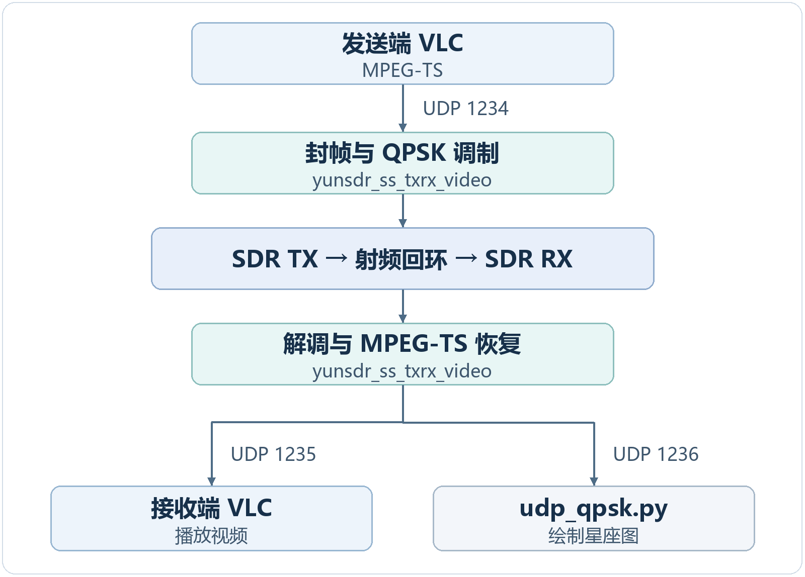
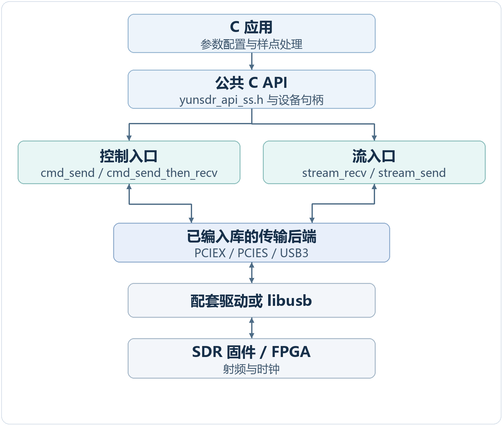
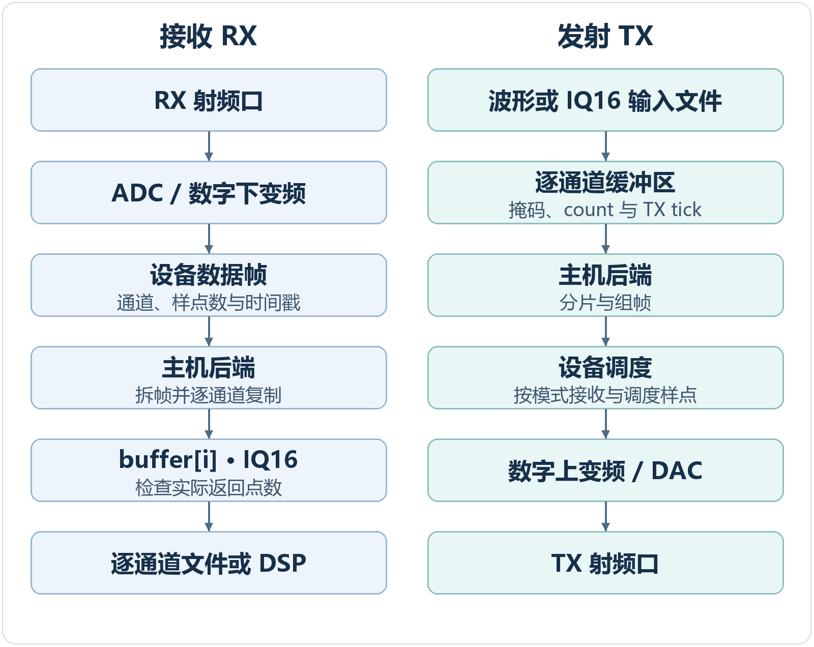

# libyunsdr 通用 C API 使用说明

适用交付包为 `libyunsdr-26-01-00.1.zip`，SDK 源码声明版本为 **`26.00.00.1`**。通过 `yunsdr_api_ss.h` 调用主机端库 `yunsdr_ss`，完成设备打开、射频配置、I/Q 收发和时间戳处理。连接方式、通道和参数范围按所用机型及固件确认。

[下载与构建](#2-下载构建与安装) · [首帧接收](#3-首帧接收) · [测试程序与参数](#4-使用随包例程) · [FM 与视频实验](#44-fm-音频接收与视频传输实验) · [函数参考](#5-函数参考) · [程序架构](#6-程序架构) · [数据格式与数据流](#7-iq-格式与数据流) · [同步与排查](#8-时间戳同步与排查)

## 1. 交付版本核对

| 核对项 | 结果 |
| --- | --- |
| 原始 ZIP | `libyunsdr-26-01-00.1.zip`，4,258,044 字节 |
| ZIP SHA-256 | `e8f31e95222e291a33cfc1fa5de707bc9867878b20dac0e21628f0e04a55e55a` |
| SDK 版本来源 | `cmake/modules/YunSDRVersion.cmake` 生成 `version.h` 中的 `YUNSDR_VERSION_STRING`，值为 `26.00.00.1`。设备打开时打印同一版本 |
| API 与例程来源 | `src/yunsdr_ss/include/yunsdr_api_ss.h`、`src/yunsdr_ss/src/`、`src/yunsdr_ss/tests/`、`src/yunsdr_ss/example/` |
| 已包含的依赖 | Windows x64 的 `lib/libpcies.lib` 和 `lib/libfirmware.lib`，Linux x86-64 的 `lib/*.a`，Linux AArch64 的 `lib/ARM64/*.a` |
| 随设备获取 | 配套驱动、FPGA 镜像及固件。ZIP 内的历史 DLL 和 SO 位于旧例程目录，按本包源码重新构建应用所用库 |
| 公开代码 | 检查时公开分支 `2026.2`（提交 `efcbf9a7cc46ed70310dfe3687b901917fbfaf6d`）的公共头文件与 ZIP 有差异。公开仓库未找到对应标签或 Release，ZIP 对应源码提交待确认 |

`libyunsdr_ss.pc` 中的 `Version: 1.0` 为本包模板的固定值。记录 SDK 时同时保留 ZIP 文件名和构建后的版本字符串。Windows x64 已验证 Release 构建与安装、随包例程帮助输出，以及第 3 节接收程序的编译和链接。Linux 构建及各机型联机结果见 [兼容矩阵](compatibility.md)。

## 2. 下载、构建与安装

### 2.1 获取 SDK 和驱动

1. 从设备随附资料取得 `libyunsdr-26-01-00.1.zip`。通过产品资料下载页面获取时，在 **C libyunsdr驱动库** 中选择该文件，按页面提示填写产品编号。Windows x64、Linux x86-64 和 Linux AArch64 使用同一份源码 ZIP。
2. Windows 运行 `Get-FileHash .\libyunsdr-26-01-00.1.zip -Algorithm SHA256`，Linux 运行 `sha256sum libyunsdr-26-01-00.1.zip`，与第 1 节的交付包哈希核对。将 ZIP 解压到新目录，在含 `CMakeLists.txt` 的一层执行后续构建命令。
3. 另行准备与机型、FPGA 镜像及主机匹配的驱动。PCIEX、PCIES 主机需要配套 XDMA 驱动。产品资料中的 **PCIE驱动** 分类提供 Windows 10/11 x64 压缩包和 Ubuntu amd64 的 XDMA DKMS 包。AArch64 主机使用相应架构的驱动或源码。USB3 主机准备 libusb 开发及运行库，并按平台配置设备访问权限。

Windows ARM64、32 位主机和 macOS 的构建组合待确认。

### 2.2 选择传输后端

| 连接串示例 | CMake 选项 | 适用条件 |
| --- | --- | --- |
| `pciex:0` | `ENABLE_PCIEX=ON` | 使用配套 XDMA 驱动，`0` 是枚举的第一个设备 |
| `pcies:0.0` | `ENABLE_PCIES=ON`，保留 `ENABLE_PCIEX=ON` | XDMA Bypass。需要包内 `libpcies` 及支持相应模式的驱动和固件。Windows x64 已验证两个选项同时开启可链接 |
| `usb3:0` | `ENABLE_USB3=ON` | USB3 后端。安装 libusb 开发文件及配套设备驱动或访问规则，`0` 为设备索引 |

`pciex:` 和 `pcies:` 的选择取决于设备固件和配套驱动。使用 `pcies:` 时检查 CMake 日志中的 `Found LIBPCIES` 和库的实际路径。USB3 主机需要正确识别设备，并允许当前用户访问。应用每次传入一个完整设备地址。支持两个句柄的例程可以使用带引号的分号分隔地址。

| 构建选项 | 交付包默认值 | 影响 |
| --- | --- | --- |
| `ENABLE_PCIEX`、`ENABLE_PCIES` | ON、ON | 共用本手册的 PCIe 构建配置。PCIES 只有在 CMake 找到匹配架构的 `libpcies` 及头文件时才编入库 |
| `ENABLE_USB3` | ON | 配置需要 libusb。仅编译 PCIEX/PCIES 时显式设为 OFF |
| `ENABLE_EXAMPLE` | OFF | 控制 `src/yunsdr_ss/example/` 下的扩展示例。三项基础测试由 `tests/` 构建，开关为 OFF 时仍会生成 |
| `ENABLE_COMLABS` | OFF | 在 `tests/` 加入 FM 和视频程序。相位校正目标还需要 `ENABLE_EXAMPLE=ON` |
| `ENABLE_FIRMWARE` | ON | 启用配套固件支持。仅构建 USB3 时关闭此项，见 2.3.3 |

### 2.3 Windows x64

#### 2.3.1 准备编译工具和驱动

1. 安装 Visual Studio 2019 或 Build Tools，选择「使用 C++ 的桌面开发」，确认包含 MSVC v142 x64/x86 工具和 Windows SDK。安装 CMake 3.16 或更新版本并加入 `PATH`，在 PowerShell 中运行 `cmake --version`。需要直接运行 `cl` 或 `lib.exe` 时，打开 Visual Studio 的 x64 开发者命令环境。
2. 将交付 ZIP 解压到用户可写目录，例如 `C:\YunSDR\libyunsdr-26-01-00.1`。进入包含 `CMakeLists.txt`、`cmake`、`lib` 和 `src` 的一层。
3. 使用 `pciex:` 或 `pcies:` 时，解压该设备配套的 Windows x64 驱动。如果交付的是 INF 驱动包，在设备管理器中定位板卡，选择「更新驱动程序 → 浏览我的电脑以查找驱动程序」，选择包含匹配 INF 的目录，随后完成安装。如果驱动包配有安装程序，则运行该程序。安装后在设备属性的「常规」页确认设备工作正常，在「驱动程序」页记录版本。
4. 使用 `usb3:` 时，将设备插入 SuperSpeed USB 端口。若设备未识别或驱动未绑定，在设备管理器的「详细信息 → 硬件 ID」核对设备标识，再安装该机型配套的 USB 驱动。确认设备状态后，再按 2.3.3 准备 libusb 的编译和运行文件。

#### 2.3.2 配置、编译和安装

在源码根目录依次运行以下命令。`build-win64` 保存构建和配置缓存，`sdk-win64` 是安装目录。

```powershell
$prefix = Join-Path (Get-Location).Path "sdk-win64"
cmake -S . -B build-win64 -G "Visual Studio 16 2019" -A x64 `
  "-DCMAKE_INSTALL_PREFIX=$prefix" -DENABLE_EXAMPLE=ON `
  -DENABLE_PCIEX=ON -DENABLE_PCIES=ON -DENABLE_PCIE=OFF -DENABLE_SFP=OFF `
  -DENABLE_USB3=OFF -DENABLE_COMLABS=OFF
Select-String -Path .\build-win64\CMakeCache.txt -Pattern '^ENABLE_|^LIBPCIES_LIBRARIES:'
cmake --build build-win64 --config Release --parallel 4
cmake --install build-win64 --config Release
```

配置结果应显示 VS2019 x64，`LIBPCIES_LIBRARIES` 应指向包内的 Windows x64 `libpcies.lib`。构建产物位于 `build-win64\lib\Release`、`build-win64\tests\Release` 和 `build-win64\example\Release`。安装后执行以下检查。

```powershell
Get-ChildItem "$prefix\include", "$prefix\bin", "$prefix\lib"
Select-String -Path "$prefix\include\version.h" -Pattern '^#define YUNSDR_VERSION_STRING'
$env:PATH = "$prefix\bin;$env:PATH"
& "$prefix\tests\yunsdr_ss\yunsdr_ss_txrx_multiport.exe" -h
```

| 安装位置 | 产物及作用 |
| --- | --- |
| `include\` | `yunsdr_api_ss.h` 用于编译应用，`version.h` 用于核对 SDK 版本 |
| `lib\` | `yunsdr_ss.lib` 为 MSVC 导入库，`libyunsdr_ss.lib` 为静态归档。此目录还安装一份 `libyunsdr_ss.dll`，启用 USB3 时另有 libusb 的导入库和 DLL |
| `bin\` | `libyunsdr_ss.dll`。将该目录加入当前会话 `PATH`，或随应用部署同一版 DLL |
| `tests\yunsdr_ss\`、`example\yunsdr_ss\` | 测试程序和启用的例程，启动命令见第 4 节 |

**使用 CMake GUI 和 Visual Studio**

1. 打开 `cmake-gui`。在 **Where is the source code** 填含 `CMakeLists.txt` 的解压目录，在 **Where to build the binaries** 填一个新目录，例如 `build-win64-gui`。
2. 点击 **Configure**，生成器选择 **Visual Studio 16 2019**，平台选择 **x64**。首次配置后将 `CMAKE_INSTALL_PREFIX` 改为实际的安装目录，例如源码下的 `sdk-win64`。勾选 `ENABLE_PCIEX`、`ENABLE_PCIES` 和 `ENABLE_EXAMPLE`，其余选项按上面的命令设置。首次配置若提示缺少 libusb，在只构建 PCIEX/PCIES 时取消 `ENABLE_USB3` 并重新配置。
3. 再点 **Configure**，检查输出里的编译器、依赖路径和错误。找不到某项依赖时，选中 **Advanced** 显示高级设置，填入匹配的库文件或头文件路径。配置通过后点击 **Generate**。
4. 用 Visual Studio 打开构建目录内的 `YUNSDRLIB.sln`。将工具栏配置切到 **Release | x64**，在解决方案资源管理器中右键构建 **ALL_BUILD**，然后构建 **INSTALL**。按本节前面的检查命令核对安装目录、版本头文件和例程帮助。

#### 2.3.3 加入 USB3 支持

解压 libusb 的 Windows x64 包。以已验证的 libusb 1.0.29 为例，头文件在 `include\libusb.h`，VS2019 x64 的导入库和 DLL 在 `VS2019\MS64\dll`。由于本包 CMake 的自动搜索路径未涵盖这一级 `VS2019` 子目录，配置时显式指定头文件和导入库。本包对能识别版本的 Windows libusb 要求至少 1.0.23。[libusb 官方发布包](https://github.com/libusb/libusb/releases/tag/v1.0.29)

```powershell
$usb = "C:\YunSDR\deps\libusb-1.0.29"
$usbDllDir = Join-Path $usb "VS2019\MS64\dll"
$usbPrefix = Join-Path (Get-Location).Path "sdk-win64-usb"
cmake -S . -B build-win64-usb -G "Visual Studio 16 2019" -A x64 `
  "-DCMAKE_INSTALL_PREFIX=$usbPrefix" "-DLIBUSB_HEADER_FILE=$usb\include\libusb.h" `
  "-Dusb_LIBRARY=$usbDllDir\libusb-1.0.lib" `
  -DENABLE_USB3=ON -DENABLE_PCIEX=ON -DENABLE_PCIES=ON `
  -DENABLE_PCIE=OFF -DENABLE_SFP=OFF -DENABLE_EXAMPLE=ON -DENABLE_COMLABS=OFF
cmake --build build-win64-usb --config Release --parallel 4
cmake --install build-win64-usb --config Release
Get-Item "$usbPrefix\lib\libusb-1.0.dll"
$env:PATH = "$usbPrefix\bin;$usbPrefix\lib;$env:PATH"
& "$usbPrefix\tests\yunsdr_ss\yunsdr_ss_rate.exe" -h
```

将 `$usb` 替换为实际解压目录。配置阶段核对 `LIBUSB_HEADER_FILE`、`usb_LIBRARY` 和 libusb 版本提示。只构建 USB3 时，在独立构建目录同时设 `-DENABLE_PCIEX=OFF -DENABLE_PCIES=OFF -DENABLE_FIRMWARE=OFF`。本包的固件更新入口依赖 PCIES 提供的链接符号，关闭 PCIES 而保留固件更新会导致链接失败。联机使用 `usb3:0` 和设备允许的采样率、频率及块长。本包 USB3 的普通收发通过多路 API，即使只选一个通道。

使用 CMake GUI 时，先新建 `build-win64-usb`，设置独立的 `CMAKE_INSTALL_PREFIX` 并勾选 `ENABLE_USB3`。在 **Advanced** 中把 `LIBUSB_HEADER_FILE` 指向 `include\libusb.h`，把 `usb_LIBRARY` 指向 `VS2019\MS64\dll\libusb-1.0.lib`。若字段尚未显示，用 **Add Entry** 以 `FILEPATH` 类型添加。再次 **Configure** 后确认已识别 libusb 版本，然后 **Generate**，按 2.3.2 构建和安装。

### 2.4 Linux x86-64 与 AArch64

#### 2.4.1 准备工具、解压源码与核对设备

以下以 Debian/Ubuntu 为例。使用 `uname -m` 区分 `x86_64` 和 `aarch64`，用 `uname -r` 记录内核版本。AArch64 优先使用包内 `lib/ARM64/` 的预编译依赖，系统 ABI 和驱动也须匹配。

```bash
sudo apt update
sudo apt install build-essential cmake pkg-config unzip file pciutils
cmake --version
unzip libyunsdr-26-01-00.1.zip -d libyunsdr-26-01-00.1
cd libyunsdr-26-01-00.1
test -f CMakeLists.txt
```

**PCIEX / PCIES 驱动。** 根据交付资料选择 DKMS 包或驱动源码。两种方式均需要与正在运行的内核匹配的头文件。AArch64 选用相应架构的驱动包或源码。

1. **使用 Ubuntu amd64 DKMS 包。** 在包含配套 `.deb` 的目录执行以下命令。将示例文件名替换成实际交付的版本。

   ```bash
   sudo apt install dkms "linux-headers-$(uname -r)"
   sudo apt install ./xdma-dkms_2020.2.2_amd64.deb
   dkms status
   sudo modprobe xdma
   ```

2. **使用配套驱动源码。** 以下适用于解压后有 `XDMA/linux-kernel/xdma` 与 `XDMA/linux-kernel/tests` 的驱动资料。安装内核头文件后，从驱动包根目录编译模块。若驱动随附的说明给出 `load_driver.sh 4`，在 `tests` 目录用该参数加载。其他版本按其脚本的参数约定执行。

   ```bash
   sudo apt install "linux-headers-$(uname -r)"
   cd XDMA/linux-kernel/xdma
   make clean
   make
   cd ../tests
   sudo ./load_driver.sh 4
   ```

3. **检查绑定。** 运行 `lspci -nnk`，找到板卡并确认 `Kernel driver in use` 为预期的驱动。检查配套驱动的设备节点，例如 XDMA 常见的 `/dev/xdma0_*`，确认运行应用的用户拥有所需权限。若模块因签名被内核拒绝，按目标系统流程为该模块签名并加载。

**USB3 依赖和识别。** 运行 `sudo apt install libusb-1.0-0-dev usbutils`。用 `pkg-config --modversion libusb-1.0` 检查开发依赖。在 `lsusb` 中核对设备标识，用 `lsusb -t` 确认设备连接到预期的速率端口。交付了 `.rules` 文件时，将该规则安装到 `/etc/udev/rules.d/`，运行 `sudo udevadm control --reload-rules` 并重新插入设备。然后在普通用户会话用 `usb3:0` 验证连接。

#### 2.4.2 配置、编译和安装

以下为 PCIEX/PCIES 配置。需要 USB3 时使用后面的独立配置命令。在仅构建 USB3 的配置中同时关闭 `ENABLE_PCIEX`、`ENABLE_PCIES` 和 `ENABLE_FIRMWARE`。Linux 步骤按交付包 CMake 核对，实机结果待验证。

```bash
cmake -S . -B build-linux -DCMAKE_BUILD_TYPE=Release \
  -DCMAKE_INSTALL_PREFIX=/usr/local -DENABLE_EXAMPLE=ON \
  -DENABLE_PCIEX=ON -DENABLE_PCIES=ON -DENABLE_PCIE=OFF -DENABLE_SFP=OFF \
  -DENABLE_USB3=OFF -DENABLE_COMLABS=OFF
cmake -LA -N build-linux | grep -E '^ENABLE_|^LIBPCIES_LIBRARIES:'
cmake --build build-linux --parallel 4
file build-linux/lib/libyunsdr_ss.so
sudo cmake --install build-linux
sudo ldconfig
grep YUNSDR_VERSION_STRING /usr/local/include/version.h
LD_LIBRARY_PATH="$PWD/build-linux/lib" ldd build-linux/tests/yunsdr_ss_txrx_multiport
LD_LIBRARY_PATH="$PWD/build-linux/lib" ./build-linux/tests/yunsdr_ss_txrx_multiport -h
```

启用 PCIES 时确认 `LIBPCIES_LIBRARIES` 来自与主机匹配的架构目录。`file` 应显示目标架构，`ldd` 的依赖列表应无 `not found`。

**Linux USB3 构建。** 在源码根目录运行。用于同一主机的 PCIEX/PCIES 也保留为开启状态。

```bash
sudo apt install libusb-1.0-0-dev
pkg-config --modversion libusb-1.0
cmake -S . -B build-linux-usb -DCMAKE_BUILD_TYPE=Release \
  -DCMAKE_INSTALL_PREFIX=/usr/local -DENABLE_EXAMPLE=ON \
  -DENABLE_PCIEX=ON -DENABLE_PCIES=ON -DENABLE_PCIE=OFF -DENABLE_SFP=OFF \
  -DENABLE_USB3=ON -DENABLE_COMLABS=OFF
cmake --build build-linux-usb --parallel 4
LD_LIBRARY_PATH="$PWD/build-linux-usb/lib" ldd build-linux-usb/tests/yunsdr_ss_rate
LD_LIBRARY_PATH="$PWD/build-linux-usb/lib" ./build-linux-usb/tests/yunsdr_ss_rate -h
```

检查 `ldd` 是否解析到该构建的 `libyunsdr_ss.so` 和系统的 `libusb-1.0.so`。若要将 USB3 版提供给系统内其他应用，运行 `sudo cmake --install build-linux-usb` 和 `sudo ldconfig`。此安装会覆盖相同路径的核心 SDK 文件。

本包在 Linux 将核心库和头文件分别安装到固定的 `/usr/local/lib` 和 `/usr/local/include`，上例也将 pkg-config 文件放到 `/usr/local/lib/pkgconfig`。测试和示例可执行文件留在 `build-linux/tests/` 和 `build-linux/example/`。若需保留多个版本，可在构建目录分别链接，并使用 `LD_LIBRARY_PATH` 指定对应构建的 `lib/`。系统安装会写入相同的核心库路径。[CMake 3.16 命令参考](https://cmake.org/cmake/help/v3.16/manual/cmake.1.html#install-a-project)

只解压 ZIP 构建可能出现 `not a git repository`，安装后的 `version.h` 仍可用于核对版本。PCIES 缺依赖时配置可能继续，需查看日志实际找到的库。FM 音频和视频的专用构建步骤见 [通信实验](#441-构建通信实验)。

## 3. 首帧接收

先按机型说明配置设备并提供已知输入信号。使用下面的最小例程打开指定地址，查询设备型号、固件和配置，然后通过普通多路 API 的单通道掩码采集第 1 路。程序沿用板卡现有射频配置，适用于支持普通多路 IQ16 接收的组合。按固件支持的接收块长调整 `IQ_COUNT`，并确保地址未开启浮点格式。以 `iq_rx.c` 保存。

```c
#include <inttypes.h>
#include <string.h>
#include "yunsdr_api_ss.h"

enum { IQ_COUNT = 30720, MAX_STREAMS = 32 };
static int16_t iq[2 * IQ_COUNT];

int main(int argc, char **argv)
{
    if (argc != 2 || argv[1][0] == '\0' ||
        strchr(argv[1], ':') == NULL || strlen(argv[1]) >= 128) {
        fprintf(stderr, "Usage: %s <device-url>\n", argv[0]);
        return 2;
    }

    YUNSDR_DESCRIPTOR *dev = yunsdr_open_device(argv[1]);
    if (!dev) {
        fprintf(stderr, "Cannot open %s\n", argv[1]);
        return 1;
    }

    int status = 1;
    uint32_t model = 0, firmware = 0;
    DEV_CFG config = NULLSubDevNULLRF;
    if (yunsdr_get_model_version(dev, &model) < 0 ||
        yunsdr_get_firmware_version(dev, &firmware) < 0 ||
        yunsdr_get_device_configuration(dev, &config) < 0 ||
        config == NULLSubDevNULLRF) {
        fprintf(stderr, "Cannot query a valid device configuration\n");
        goto done;
    }
    printf("model=0x%08" PRIx32 " firmware=0x%08" PRIx32 " config=0x%x\n",
           model, firmware, (unsigned)config);

    void *buffers[MAX_STREAMS] = { iq };
    uint64_t timestamp = 0;
    int32_t nread = yunsdr_read_samples_multiport(
        dev, buffers, IQ_COUNT, UINT32_C(1), &timestamp);
    if (nread != IQ_COUNT) {
        fprintf(stderr, "RX returned %" PRId32 ", expected %d\n", nread, IQ_COUNT);
        goto done;
    }

    FILE *out = fopen("rx_ch1.iq16", "wb");
    if (!out) {
        perror("rx_ch1.iq16");
        goto done;
    }
    size_t written = fwrite(iq, 2 * sizeof(iq[0]), (size_t)nread, out);
    int file_status = fclose(out);
    if (written != (size_t)nread || file_status != 0) {
        fprintf(stderr, "Incomplete write to rx_ch1.iq16\n");
        goto done;
    }

    printf("%" PRId32 " IQ samples, device timestamp=%" PRIu64 "\n",
           nread, timestamp);
    status = 0;

done:
    yunsdr_close_device(dev);
    return status;
}
```

Windows 在 VS x64 开发者 PowerShell 中编译，`$prefix` 指向第 2.3 节的安装目录。以下例子使用 `pciex:0`，按板卡实际传输方式更换。

```powershell
cl /nologo /W4 /TC /D_CRT_SECURE_NO_WARNINGS /I"$prefix\include" iq_rx.c /link /LIBPATH:"$prefix\lib" yunsdr_ss.lib
$env:PATH = "$prefix\bin;$env:PATH"
.\iq_rx.exe "pciex:0"
(Get-Item .\rx_ch1.iq16).Length
```

Linux 安装后可通过 pkg-config 链接动态库。

```bash
export PKG_CONFIG_PATH="/usr/local/lib/pkgconfig${PKG_CONFIG_PATH:+:$PKG_CONFIG_PATH}"
cc -std=c99 -Wall -Wextra iq_rx.c -o iq_rx $(pkg-config --cflags --libs libyunsdr_ss)
./iq_rx 'pciex:0'
wc -c < rx_ch1.iq16
```

成功时文件长度为 `30720 × 4 = 122880` 字节。文件大小只能核对写入量，信号有效性需要随已知输入检查 I/Q 波形或频谱。需要由程序设置射频时，可在接收前按机型映射调用 `yunsdr_set_rx_sampling_freq`、`yunsdr_set_rx_lo_freq`、`yunsdr_set_rx_rf_bandwidth`，并按增益模式调用相应增益接口，逐项检查返回值。启用设备时间戳及其同步方式见第 8 节。

## 4. 使用随包例程

### 4.1 从哪里运行

先打开 PowerShell 或 Bash，进入含 `CMakeLists.txt` 的 SDK 源码根目录，运行本系统的准备命令。变量使用绝对路径。随后可在同一终端切到测试工作目录，`.dat` 文件写入程序启动时的当前目录。帮助输出可用于检查动态库是否能加载，部分程序显示帮助后返回非零退出码。

| 产物 | Windows x64 | Linux |
| --- | --- | --- |
| 三项基础测试 | `sdk-win64\tests\yunsdr_ss\*.exe`，安装前位于 `build-win64\tests\Release\` | `build-linux/tests/` |
| 扩展示例 | `sdk-win64\example\yunsdr_ss\*.exe`，安装前位于 `build-win64\example\Release\` | `build-linux/example/` |
| USB3 版基础测试 | `sdk-win64-usb\tests\yunsdr_ss\` | `build-linux-usb/tests/` |
| FM 音频和视频 | `sdk-win64-comlabs\tests\yunsdr_ss\` | `build-linux-comlabs/tests/` |

表中使用第 2 节和 4.4.1 的默认目录。Linux 的系统安装写入头文件、库和 pkg-config 文件，可执行例程从上表的构建目录启动。

```powershell
$sdkRoot = (Get-Location).Path
$prefix = Join-Path $sdkRoot "sdk-win64"
$testDir = Join-Path $prefix "tests\yunsdr_ss"
$exampleDir = Join-Path $prefix "example\yunsdr_ss"
$env:PATH = "$prefix\bin;$prefix\lib;$env:PATH"
& "$testDir\yunsdr_ss_rate.exe" -h
& "$testDir\yunsdr_ss_txrx_multiport.exe" -h
& "$testDir\yunsdr_ss_trx_multiport_zerocopy.exe" -h
```

```bash
sdk_root="$PWD"
build_dir="$sdk_root/build-linux"
test_dir="$build_dir/tests"
example_dir="$build_dir/example"
export LD_LIBRARY_PATH="$build_dir/lib"
"$test_dir/yunsdr_ss_rate" -h
"$test_dir/yunsdr_ss_txrx_multiport" -h
"$test_dir/yunsdr_ss_trx_multiport_zerocopy" -h
```

完成准备后，按主机系统选择下面的联机命令。示例中的频率、采样率、块长和增益须与实际机型和输入信号匹配。执行带 TX 的测试前，按板卡规定接好有线回环和衰减器。Windows 的零拷贝程序要在交互式终端直接运行，管道或重定向可能导致程序在解析参数前退出。

### 4.2 通用参数

| 参数 | 含义与常用写法 |
| --- | --- |
| `-a` | 设备连接串。`'pciex:0'`、`'pcies:0.0'`、`'usb3:0'`。多设备程序可接受如 `'pcies:0.0;pcies:0.1'` 的参数 |
| `-f`、`-s` | 中心频率（Hz）与 I/Q 采样率（样点/秒），例如 `-f 2400000000 -s 30720000` |
| `-g`、`-G` | RX 增益（dB）与例程内部 TX 增益参数。例程将 `-G` 换算为 API 的 TX 衰减值 |
| `-c`、`-C` | 普通例程分别是 RX 和 TX 掩码。`0x1` 选第 1 路，`0x3` 选第 1、2 路。`yunsdr_ss_trx_multiport_zerocopy` 的 `-c` 为连续通道数 |
| `-N` | 基础收发程序每次调用的每路复数样点数。基础零拷贝程序按 `-m` 指定的每帧样点数划分 `-N` |
| `-t`、`-T` | 部分程序的单音偏移（Hz）及提前样点数，区分大小写 |
| `-i` | 支持时读取本地 IQ16 文件。检查输入长度和程序预期的块长。Windows 若源码以 `r` 读取二进制 IQ，需改用 `rb` 后重编 |

以本包的参数解析器为准。`yunsdr_ss_rate`、`yunsdr_ss_txrx_multiport` 和 `yunsdr_ss_txrx_time` 的帮助列有 `-E`，实际的 `getopt` 选项串里没有它。同步等待使用程序默认值。`yunsdr_ss_txrx_multiport` 运行固定的有限帧收发流程，模式参数 `-r` 用于 `yunsdr_ss_rate` 和 `yunsdr_ss_txrx_time`。

### 4.3 基础测试程序

**`yunsdr_ss_rate` 的单通道接收测试**

`-r 1` 只跑 RX 数据流，`-r 0` 跑 TX，`-r 2` 跑双向。`-n` 是统计轮数，默认 21，以下用 3 轮做快速检查。终端速率按请求点数及耗时估算，程序没有逐块校验实际返回点数，需结合溢出等事件和第 3 节的首帧程序确认有效数据。源码用 `1024²` 换算，在日志中将单位标为 `Mbyte/s`。

Windows PowerShell

```powershell
& "$testDir\yunsdr_ss_rate.exe" -a 'pciex:0' -f 2400000000 -s 30720000 -g 5 -c 0x1 -C 0x0 -N 30720 -r 1 -n 3
```

Linux Bash

```bash
"$test_dir/yunsdr_ss_rate" -a 'pciex:0' -f 2400000000 -s 30720000 -g 5 -c 0x1 -C 0x0 -N 30720 -r 1 -n 3
```

**USB3 单通道接收测试**

先按 2.3.3 或 2.4.2 构建 USB3 版。下例请求 10 MS/s 和每次 30720 个复数样点，按 USB3 设备支持的频率、采样率和块长调整。这项测试使用 `usb3:0` 的普通多路 I/Q 接口，掩码 `0x1` 只启用本地第 1 路。

Windows PowerShell

```powershell
$usbPrefix = Join-Path $sdkRoot "sdk-win64-usb"
$env:PATH = "$usbPrefix\bin;$usbPrefix\lib;$env:PATH"
& "$usbPrefix\tests\yunsdr_ss\yunsdr_ss_rate.exe" -a 'usb3:0' -f 2400000000 -s 10000000 -g 5 -c 0x1 -C 0x0 -N 30720 -r 1 -n 3
```

Linux Bash

```bash
usb_build="$sdk_root/build-linux-usb"
LD_LIBRARY_PATH="$usb_build/lib" "$usb_build/tests/yunsdr_ss_rate" \
  -a 'usb3:0' -f 2400000000 -s 10000000 -g 5 -c 0x1 -C 0x0 -N 30720 -r 1 -n 3
```

**`yunsdr_ss_txrx_multiport` 的多通道有限帧收发**

程序发送内置单音或 `-i` 指定的文件，随后写出逐通道 IQ16 采样。`-N 30720` 时每个完整文件为 122880 字节。单设备示例生成 `rx_iq_samples_ch0.dat`、`rx_iq_samples_ch1.dat`。其中 `ch0` 表示设备本地第 1 路。第二个句柄的文件前缀为 `rx2_iq_samples`。程序在预定帧按配置写盘，文件长度正确时仍要检查信号内容及终端的时间戳提示。

Windows PowerShell

```powershell
& "$testDir\yunsdr_ss_txrx_multiport.exe" -a 'pciex:0' -f 2400000000 -s 30720000 -g 5 -G 70 -c 0x3 -C 0x3 -N 30720
Get-Item -LiteralPath .\rx_iq_samples_ch0.dat, .\rx_iq_samples_ch1.dat | Select-Object Name, Length
```

Linux Bash

```bash
"$test_dir/yunsdr_ss_txrx_multiport" -a 'pciex:0' -f 2400000000 -s 30720000 -g 5 -G 70 -c 0x3 -C 0x3 -N 30720
wc -c rx_iq_samples_ch0.dat rx_iq_samples_ch1.dat
```

**查看接收文件。** 将 `check.m` 与 `read_short_binary.m` 放到采样文件所在的测试目录，打开 `check.m`，把 `read_short_binary(...)` 中的路径替换为实际文件，例如 `rx_iq_samples_ch0.dat`。在 MATLAB 中切换到测试目录并运行 `check`，查看 I/Q 时序与复平面图。也可在测试目录运行随包 `single_tone.py`，先安装 NumPy、Matplotlib，并把脚本的默认采样率改成实际值。脚本会读取符合 `rx_iq_samples_ch*.dat` 命名的文件。

**`yunsdr_ss_trx_multiport_zerocopy` 的 PCIEX 全双工测试**

使用 `pciex:`。`-c` 填从本地第 1 路起的连续通道数，`-N` 填每路有效点数，`-m` 填每路每帧点数。本例 `30720 / 7680 = 4`，连接串设定的接收帧长与 `-m` 相同。程序持续收发并输出速率，用 Ctrl+C 结束。

Windows PowerShell

```powershell
& "$testDir\yunsdr_ss_trx_multiport_zerocopy.exe" -a 'pciex:0,nsamples_recv_frame:7680' `
  -f 500000000 -s 30720000 -g 6 -G 65 -c 1 -N 30720 -m 7680
```

Linux Bash

```bash
"$test_dir/yunsdr_ss_trx_multiport_zerocopy" -a 'pciex:0,nsamples_recv_frame:7680' \
  -f 500000000 -s 30720000 -g 6 -G 65 -c 1 -N 30720 -m 7680
```

#### 4.3.1 PCIES 双句柄测试

1. 在使用配套 XDMA 驱动及支持 4T4R 拆分的 Bypass 镜像时，首块设备可提供 `pcies:0.0` 和 `pcies:0.1` 两个地址。应用分别打开两个句柄，每个句柄上 `0x3` 都选择本地两路。先用已知信号确认两组物理射频口的映射。
2. 在按机型接好测试链路并确认支持相应采样率后，运行下面的有限帧同步收发与速率测试。地址参数的引号须保留，让分号及两个地址作为一个参数传入。示例的 `-s 122880000` 是每路 122.88 MS/s，`-N 122880` 是每路 1 ms 的样点数。根据目标设备的能力调整频率、采样率、块长和增益。

   Windows PowerShell

   ```powershell
   & "$testDir\yunsdr_ss_txrx_multiport.exe" -a 'pcies:0.0;pcies:0.1' `
     -f 2400000000 -s 122880000 -g 5 -G 70 -c 0x3 -C 0x3 -N 122880
   & "$testDir\yunsdr_ss_rate.exe" -a 'pcies:0.0;pcies:0.1' `
     -f 2400000000 -s 122880000 -g 5 -G 70 -c 0x3 -C 0x3 -N 122880 -r 2 -n 3
   ```

   Linux Bash

   ```bash
   "$test_dir/yunsdr_ss_txrx_multiport" -a 'pcies:0.0;pcies:0.1' \
     -f 2400000000 -s 122880000 -g 5 -G 70 -c 0x3 -C 0x3 -N 122880
   "$test_dir/yunsdr_ss_rate" -a 'pcies:0.0;pcies:0.1' \
     -f 2400000000 -s 122880000 -g 5 -G 70 -c 0x3 -C 0x3 -N 122880 -r 2 -n 3
   ```

3. 确认启动日志分别列出两个地址，且两次打开均成功。有限帧测试应为每个句柄生成两路文件，第一组以 `rx_iq_samples_` 开头，第二组以 `rx2_iq_samples_` 开头。本例每个完整文件为 491520 字节。对照日志中的起始时间戳和各路文件中已知信号的位置；速率测试再检查两组设备的速率与收发事件计数。[IQX8400 接入页](devices/iqx8400.md)

### 4.4 FM 音频接收与视频传输实验

先用 4.3 的基础例程验证设备连接与 I/Q 收发。下面的运行命令使用 `pciex:0`。使用 `pcies:` 或 `usb3:` 时，需核对后端、设备的采样能力与收发方式。各组合的联机结果见 [兼容矩阵](compatibility.md)。

[构建通信实验](#441-构建通信实验) · [FM 音频接收](#442-fm-音频接收) · [视频传输](#443-视频传输)

#### 4.4.1 构建通信实验

`-DENABLE_COMLABS=ON` 会让 `tests/` 构建 `yunsdr_ss_rx_fm_audio` 和 `yunsdr_ss_txrx_video`。两个程序都链接单精度 FFTW3F。本包的 CMake 还会查找双精度 FFTW3，FM 另需 PortAudio v19，Linux 的 FM 构建还需 ALSA 开发包。若同时开启 `ENABLE_EXAMPLE`，还会构建 `yunsdr_ss_trx_multiport_cali`。

##### Windows x64

**准备 FFTW。** 取得 FFTW 官方 Windows x64 压缩包。本文验证使用 `fftw-3.3.5-dll64.zip`。解压后确认 `fftw3.h`、两份 DLL 和对应的 `.def` 文件。在 Visual Studio 2019 x64 开发者 PowerShell 中进入解压目录，用 `lib.exe` 生成 MSVC 导入库，留在原 DLL 旁边。[FFTW Windows 安装说明](https://www.fftw.org/install/windows.html)

```powershell
lib.exe /nologo /machine:x64 /def:libfftw3-3.def /out:libfftw3-3.lib
lib.exe /nologo /machine:x64 /def:libfftw3f-3.def /out:libfftw3f-3.lib
```

**准备 PortAudio。** 可以使用设备随附的 x64 头文件、导入库和匹配的 DLL。若自行编译，本文验证用 v19.7.0 源码，以 VS2019 x64 构建 Release 共享库。以下路径改成实际位置。若用 CMake 4 且遇到旧工程策略版本错误，在配置命令追加 `"-DCMAKE_POLICY_VERSION_MINIMUM=3.5"`。[PortAudio v19.7.0 源码](https://github.com/PortAudio/portaudio/releases/tag/v19.7.0) · [PortAudio CMake 指南](https://files.portaudio.com/docs/v19-doxydocs/compile_cmake.html)

```powershell
$paSrc = "C:\YunSDR\deps\portaudio-19.7.0"
$pa = "C:\YunSDR\deps\portaudio-x64"
cmake -S $paSrc -B "$paSrc\build-x64" -G "Visual Studio 16 2019" -A x64 `
  "-DCMAKE_INSTALL_PREFIX=$pa" -DPA_BUILD_SHARED=ON -DPA_BUILD_STATIC=OFF -DPA_USE_ASIO=OFF
cmake --build "$paSrc\build-x64" --config Release --parallel 4
cmake --install "$paSrc\build-x64" --config Release
Copy-Item "$pa\bin\portaudio_x64.dll" "$pa\lib\portaudio_x64.dll"
```

安装生成 `include\portaudio.h`、`lib\portaudio_x64.lib` 和 `bin\portaudio_x64.dll`。最后一行把 DLL 放在导入库旁边，以配合 libyunsdr 本包的构建后复制规则。若使用产品随附的预编译库，保证 DLL 与所选导入库同目录、同名且架构匹配。

**配置 libyunsdr。** 回到其源码根目录。以下构建 PCIEX/PCIES 版。`load-pkgconfig.cmake` 用于在项目初始化时加载 CMake 的 PkgConfig 模块。本包关闭 USB3 后不会主动加载该模块，启用通信实验时可能报 `Unknown CMake command "PKG_CHECK_MODULES"`。使用这个外部文件即可保持交付源码原样。若还需 USB3，将 `ENABLE_USB3` 改为 `ON`，并加入 [Windows USB3 构建](#233-加入-usb3-支持) 中的 libusb 路径选项。

```powershell
$fftw = "C:\YunSDR\deps\fftw-3.3.5-dll64"
$pa = "C:\YunSDR\deps\portaudio-x64"
$comPrefix = Join-Path (Get-Location).Path "sdk-win64-comlabs"
$hook = Join-Path (Get-Location).Path "load-pkgconfig.cmake"
'find_package(PkgConfig QUIET)' | Set-Content -LiteralPath $hook -Encoding ascii
cmake -S . -B build-win64-comlabs -G "Visual Studio 16 2019" -A x64 `
  "-DCMAKE_INSTALL_PREFIX=$comPrefix" "-DCMAKE_PROJECT_INCLUDE=$hook" `
  -DENABLE_COMLABS=ON -DENABLE_EXAMPLE=ON -DENABLE_USB3=OFF `
  -DENABLE_PCIEX=ON -DENABLE_PCIES=ON -DENABLE_PCIE=OFF -DENABLE_SFP=OFF `
  "-DFFTW3_INCLUDE_DIRS=$fftw" "-DFFTW3F_INCLUDE_DIRS=$fftw" `
  "-DFFTW3_LIBRARIES=$fftw\libfftw3-3.lib" "-DFFTW3F_LIBRARIES=$fftw\libfftw3f-3.lib" `
  "-DPORTAUDIO_INCLUDE_DIRS=$pa\include" "-DPORTAUDIO_LIBRARIES=$pa\lib\portaudio_x64.lib"
cmake --build build-win64-comlabs --config Release --parallel 4
cmake --install build-win64-comlabs --config Release
$comTests = Join-Path $comPrefix "tests\yunsdr_ss"
$env:PATH = "$comPrefix\bin;$pa\bin;$fftw;$env:PATH"
Get-ChildItem $comTests
& "$comTests\yunsdr_ss_rx_fm_audio.exe" -h
& "$comTests\yunsdr_ss_txrx_video.exe" -h
```

**使用 CMake GUI**

1. 打开 `cmake-gui`，指定源码根目录和独立的 `build-win64-comlabs`。点击 **Configure**，选择 **Visual Studio 16 2019**、**x64**。将 `CMAKE_INSTALL_PREFIX` 设置为实际的 `sdk-win64-comlabs` 路径，勾选 `ENABLE_COMLABS`、`ENABLE_EXAMPLE`，并按上一段命令设置后端选项。
2. 用 **Add Entry** 添加 `CMAKE_PROJECT_INCLUDE`，类型为 **FILEPATH**，值为前面创建的 `load-pkgconfig.cmake` 完整路径。填写下列依赖项。界面上已有同名变量时，直接修改其值。

   | CMake 变量 | 类型 | 填写内容 |
   | --- | --- | --- |
   | `FFTW3_INCLUDE_DIRS`、`FFTW3F_INCLUDE_DIRS` | PATH | 包含 `fftw3.h` 的目录 |
   | `FFTW3_LIBRARIES` | FILEPATH | `libfftw3-3.lib` 的完整路径 |
   | `FFTW3F_LIBRARIES` | FILEPATH | `libfftw3f-3.lib` 的完整路径 |
   | `PORTAUDIO_INCLUDE_DIRS` | PATH | 包含 `portaudio.h` 的目录 |
   | `PORTAUDIO_LIBRARIES` | FILEPATH | `portaudio_x64.lib` 的完整路径 |

3. 再点 **Configure**，检查 FFTW、PortAudio 解析到的文件，然后 **Generate**。用 Visual Studio 打开构建目录下的 `YUNSDRLIB.sln`，切到 **Release | x64**，依次构建 **ALL_BUILD** 和 **INSTALL**。
4. 在安装目录的 `tests\yunsdr_ss\` 检查 `yunsdr_ss_rx_fm_audio.exe`、`yunsdr_ss_txrx_video.exe`、`udp_qpsk.py` 及依赖 DLL。分别运行两个可执行文件的 `-h`，确认程序可以启动并显示参数。

##### Linux x86-64 与 AArch64

先完成核心构建所需的准备。以下在 Debian/Ubuntu 的 libyunsdr 源码根目录运行。启用 USB3 时先装 `libusb-1.0-0-dev` 并改为 `-DENABLE_USB3=ON`。启动 FM 实验的主机还须有当前用户可访问的音频输出设备。

```bash
sudo apt install libasound2-dev portaudio19-dev libfftw3-dev
pkg-config --modversion portaudio-2.0 fftw3 fftw3f
printf '%s\n' 'find_package(PkgConfig QUIET)' > load-pkgconfig.cmake
cmake -S . -B build-linux-comlabs -DCMAKE_BUILD_TYPE=Release \
  -DCMAKE_INSTALL_PREFIX=/usr/local -DCMAKE_PROJECT_INCLUDE="$PWD/load-pkgconfig.cmake" \
  -DENABLE_COMLABS=ON -DENABLE_EXAMPLE=ON -DENABLE_USB3=OFF \
  -DENABLE_PCIEX=ON -DENABLE_PCIES=ON -DENABLE_PCIE=OFF -DENABLE_SFP=OFF
cmake --build build-linux-comlabs --parallel 4
sudo cmake --install build-linux-comlabs
sudo ldconfig
com_tests="$PWD/build-linux-comlabs/tests"
export LD_LIBRARY_PATH="$PWD/build-linux-comlabs/lib"
ldd "$com_tests/yunsdr_ss_rx_fm_audio"
ldd "$com_tests/yunsdr_ss_txrx_video"
"$com_tests/yunsdr_ss_rx_fm_audio" -h
"$com_tests/yunsdr_ss_txrx_video" -h
```

Linux 的程序和 `udp_qpsk.py` 在 `build-linux-comlabs/tests/`。上面设置的动态库路径用于加载这套通信实验构建。配置日志要能找到 PortAudio、ALSA 和 FFTW，`ldd` 应解析到 `build-linux-comlabs/lib/libyunsdr_ss.so` 及系统的依赖库。Windows 已验证这两个目标的编译、安装和帮助输出。Linux 构建与两种通信实验的射频联调见 [兼容矩阵](compatibility.md)。

使用图形界面时，可在 Debian/Ubuntu 安装 `cmake-qt-gui`，从源码目录启动 `cmake-gui`。设置源码目录和 `build-linux-comlabs`，首次 **Configure** 选择 **Unix Makefiles**，将 `CMAKE_BUILD_TYPE` 设为 `Release`，其余变量按上述命令设置。再次 **Configure** 并 **Generate**，随后执行终端里的编译、安装和验证命令。

#### 4.4.2 FM 音频接收

##### 接线和参数

1. 将适用天线接到设备的第 1 个 RX 口，或用测试信号源输入已知 FM 信号。确认该设备的接收频段覆盖所选频率。将主机默认输出设为预期的扬声器或耳机。
2. 用 `-a` 指定设备，`-f` 填广播中心频率（Hz），`-g` 填 RX 增益（dB），`-c 0x1` 选择本地第 1 路。`91600000` 对应 91.6 MHz，换成实际可接收的频点。
3. 显式传入 `-s 10000000`。它配置设备采样率，本包 FM 解调内部固定使用 10 MS/s 和 30720 点的基本接收帧。先确认设备能实际提供 10 MS/s，保持连接串的接收帧长默认值。`-N` 不改变解调链路的基本接收帧。

##### 启动并验证

在完成 4.4.1 构建和路径配置的终端启动。按主机系统选用下面的命令。

```powershell
& "$comTests\yunsdr_ss_rx_fm_audio.exe" -a 'pciex:0' -f 91600000 -s 10000000 -g 10 -c 0x1
```

```bash
"$com_tests/yunsdr_ss_rx_fm_audio" -a 'pciex:0' -f 91600000 -s 10000000 -g 10 -c 0x1
```

数据从 RX 射频输入进入 SDK 的多路 I/Q 接收，经带宽处理、FM 解调和降采样，由 PortAudio 播放。本版按 `10 MHz / 40 / 5` 生成约 50 kHz 的音频输出。看到设备版本、接收帧长和 PortAudio 初始化后，收听所选电台并确认内容、连续性。结束时按 Ctrl+C。

- 打不开设备时先用 `yunsdr_ss_rate -r 1` 或首帧接收程序检查同一设备地址。
- 能接收 I/Q 但没有音频时，核对频点、天线、增益和主机默认输出设备。若 PortAudio 报设备或采样率错误，确认默认输出及其后端能接受例程的音频格式。
- 听到失真或断音时，先检查信号是否过弱或饱和，再核对实际 I/Q 采样率、接收块和设备溢出事件。

#### 4.4.3 视频传输

##### 链路与端口

随包程序在一个进程内处理 TX 和 RX。在同一主机上安装 VLC，准备支持 10 MS/s 双向收发的设备。把选定的 TX、RX 口按设备说明接成带衰减的射频回环，确认发射功率与 RX 输入范围。输入可用配套测试素材 `bbc_video.ts`，或者用 VLC 将自己的短视频封装为 MPEG-TS。



| 本机端口 | 发送方 | 接收方 |
| --- | --- | --- |
| `127.0.0.1:1234` | 输入 VLC | `yunsdr_ss_txrx_video` 的视频输入 |
| `127.0.0.1:1235` | `yunsdr_ss_txrx_video` | 输出 VLC，网络 URL 为 `udp://@:1235` |
| `127.0.0.1:1236` | `yunsdr_ss_txrx_video` | 可选的 `udp_qpsk.py` |

地址和端口由交付源码 `src/yunsdr_ss/tests/rx_video.c` 固定。`-a` 为 SDR 连接串，视频文件由 VLC 打开并经 UDP 输入。`-N` 不改变调制解调链路的基本接收帧。要调整 UDP 端口需修改相应源码、重编，并同步调整 VLC 与脚本。

##### 配置 VLC 并启动

1. **先启动接收 VLC。** 若 VLC 设置为只允许运行一个实例，在「工具 → 首选项 → 界面」关闭单实例限制，以便分别打开发送和接收窗口。接收窗口选择「媒体 → 打开网络串流」，输入 `udp://@:1235`，点击「播放」。
2. **启动 SDR 视频程序。** 在完成 4.4.1 构建和路径配置的终端执行。显式指定 `-s 10000000`，匹配例程固定的内部调制和解调时基。`-f` 为 RF 中心频率（Hz），以测试链路可用的频点替换。`-c 0x1 -C 0x1` 选本地第 1 路 RX/TX，`-g` 与 `-G` 按回环电平调整。

   ```powershell
   & "$comTests\yunsdr_ss_txrx_video.exe" -a 'pciex:0' -f 500000000 -s 10000000 -g 6 -G 65 -c 0x1 -C 0x1
   ```

   ```bash
   "$com_tests/yunsdr_ss_txrx_video" -a 'pciex:0' -f 500000000 -s 10000000 -g 6 -G 65 -c 0x1 -C 0x1
   ```

3. **用另一 VLC 实例发送。**

   - 选择「媒体 → 串流」，在「文件」选项卡添加本地测试文件，点击「串流」。核对输入后点「下一个」。
   - 在目标设置里，将「新目标」选为 **UDP（legacy）**，点击「添加」，填写地址 `127.0.0.1` 和端口 `1234`。需要同时查看发送端画面时勾选「本地显示」。点击「下一个」。
   - 若输入已是合适的低码率 MPEG-TS 文件，可关闭转码。其他文件勾选「激活转码」，选择 **Video - MPEG-2 + MPGA (TS)**。通过配置旁的编辑按钮核对「封装」为 **MPEG-TS**，在视频和音频编解码器页设置所需码率，保存配置。初次测试使用低分辨率、低码率的片段。
   - 点击「下一个」，检查串流配置中的目标端口为 `1234`，最后点击「流」开始发送。

4. **检查接收画面和声音。** 输出 VLC 应能连续播放输入素材。若需要核对本机监听，Windows 可运行 `Get-NetUDPEndpoint -LocalPort 1234,1235`，Linux 可运行 `ss -lunp`。先检查 `1234` 对应 SDR 程序、`1235` 对应接收 VLC。若两个端口均已监听且播放器仍在等待，继续检查输入视频是否开始串流和射频回环是否恢复出 MPEG-TS。
5. **结束实验。** 停止发送 VLC 的串流，在 SDR 程序终端按 Ctrl+C，再关闭接收 VLC 和绘图脚本。

##### 查看 QPSK 星座图和排查

在有图形桌面的主机另开终端，切换到 libyunsdr 源码根目录。以下脚本路径对应 4.4.1 的构建和安装目录，使用自定义目录时替换该路径。首次使用时在工作目录建立虚拟环境并安装 NumPy、Matplotlib。Debian/Ubuntu 若提示缺少 venv，安装 `python3-venv`；绘图需要可用的 Matplotlib 图形后端。脚本无需额外参数。

```powershell
python -m venv .venv
& .\.venv\Scripts\python.exe -m pip install numpy matplotlib
& .\.venv\Scripts\python.exe ".\sdk-win64-comlabs\tests\yunsdr_ss\udp_qpsk.py"
```

```bash
python3 -m venv .venv
.venv/bin/python -m pip install numpy matplotlib
.venv/bin/python "./build-linux-comlabs/tests/udp_qpsk.py"
```

接通链路后观察 QPSK 点簇及 VLC 是否稳定播放。脚本在本机 `1236` 收包超时时会生成随机噪声作为显示数据，因此仅出现散点图还需检查实际 UDP 数据。

- **VLC 一直等待。** 核对发送目标 `127.0.0.1:1234`、接收 URL `udp://@:1235` 以及 VLC 双实例，再检查端口是否已被占用。
- **有数据却花屏或卡顿。** 核对 MPEG-TS 封装和 VLC 编解码配置，先降低输入视频和音频码率。再检查实际 10 MS/s、回环幅度、增益、收发事件以及星座图。
- **星座图无有效点簇。** 检查 `1236` 的实际数据、RX/TX 端口映射和射频回环。先以基础单音收发例程建立基线，再启动视频实验。

### 4.5 扩展示例和设备诊断

扩展示例由 `ENABLE_EXAMPLE=ON` 构建。表中只列各程序特有或关键的选项，频率、采样率、增益和掩码仍按 4.2 节填写。专用设备模式先按机型配套说明设置。部分 `-h` 输出沿用了旧参数说明，下面以本包解析器和调用路径为准。

| 程序 | 用途 | 关键参数和结果 |
| --- | --- | --- |
| `yunsdr_ss_txrx_time` | 定时 TX、RX 与双向收发 | `-r 0/1/2` 选 TX/RX/双向，`-T` 为提前样点数。观察当前设备 tick、收发时刻与通道事件 |
| `yunsdr_ss_tx_multiport` | 多路发送或持续接收并分批保存 | `-M 0` 为 TX，`-M 1` 为 RX，`-i` 指定波形。RX 的 `-n` 控制保存时长（源码将毫秒换算为块数），`-b` 为保存间隔（分钟），文件带时间和通道后缀 |
| `yunsdr_ss_tx_regular_multiport` | 用多路 API 周期性调度收发 | `-c`、`-C` 选通道，`-N` 指定块大小，`-T` 为提前样点。关注连续运行的收发日志和时序 |
| `yunsdr_ss_tx_loop_zero` | 零拷贝路径收发及循环发送 | `-M 0/1` 选 TX/RX，`-c`、`-C` 为掩码。按当前设备帧配置和源码校核 `-N`，TX 按例程组帧 |
| `yunsdr_ss_rate_zerocopy` | 按发送/接收帧长测零拷贝速率 | `-r 0/1/2` 选方向，`-m` 为 RX 帧长，`-M` 为 TX 帧长，`-c`、`-C` 是位掩码，`-n` 为统计轮数（默认 21） |
| `yunsdr_ss_utc_gps` | 测试 GPS/UTC、PPS 和设备时间戳 | `-a` 选设备，`-c`、`-C`、`-N` 设置测试流。观察 UTC、GPS 状态和 tick 日志，需设备支持相关时钟源 |
| `yunsdr_ss_utc_gps_zerocopy` | GPS/UTC 测试的原始帧路径 | 在设备参数之外，用 `-m` 设置接收帧长，对照固件送出的 PPS 和时间戳。发端帧长保持源码默认值，本版帮助列出的 `-M` 未进入参数解析 |
| `yunsdr_ss_trx_multiport_cali` | 发送、接收并测试相位校正 | 同时开启 `ENABLE_COMLABS` 与 `ENABLE_EXAMPLE`。`-e` 选择源码中的校正模式，`-v` 在相位计算中作为补偿量使用，配置值由机型/校准流程给出 |
| `yunsdr_ss_commen` | 机型相关 SYSREF 控制示例 | `-a` 选设备，`-v` 写入扩展命令的 SYSREF 值。仅在配套资料定义该值时执行 |
| `yunsdr_ss_firmware_update` | 查询 Flash 或查看/更新匹配镜像 | `-a` 选地址，`-info` 查询，`-f` 指定固件文件。更新按机型配套流程操作，日常安装验收只运行 `-h` |

定时双向测试示例。若只接收，可用 `-r 1` 选择 RX 分支。此例的 `-T 0` 使用默认提前样点设置，非零补偿根据联机测出的时延确定。持续运行时用 Ctrl+C 结束。

Windows PowerShell

```powershell
& "$exampleDir\yunsdr_ss_txrx_time.exe" -a 'pciex:0' -f 2400000000 -s 30720000 `
  -g 5 -G 65 -c 0x1 -C 0x1 -N 30720 -r 2 -T 0
```

Linux Bash

```bash
"$example_dir/yunsdr_ss_txrx_time" -a 'pciex:0' -f 2400000000 -s 30720000 \
  -g 5 -G 65 -c 0x1 -C 0x1 -N 30720 -r 2 -T 0
```

`yunsdr_ss_pcies_multiport.c` 和 `yunsdr_ss_mrf16.c` 在 ZIP 中附带源码，本版由 CMake 的 `if(0)` 禁用。PCIES 联机使用 4.3.1 节的两个程序。

## 5. 函数参考

完整声明在安装后的 `include/yunsdr_api_ss.h`。下表中的函数名省略共同前缀 `yunsdr_`，另标明的样点转换函数使用原名。

### 5.1 生命周期、索引与返回值

| 函数或参数 | 数据与行为 |
| --- | --- |
| `open_device(url)`、`close_device(dev)` | 打开成功返回 `YUNSDR_DESCRIPTOR *`，失败返回 `NULL`。停止工作线程后关闭有效句柄一次，关闭后释放应用自己的缓冲区 |
| `get_device_configuration(dev, &cfg)` | 返回 `DEV_CFG` 拓扑编码。部分链路异常也返回 0 并写入 `NULLSubDevNULLRF`，或返回实际探测到的部分拓扑，应核对返回值和编码 |
| `get_model_version(dev, &version)` | 返回设备型号/版本字段，按机型解释 |
| `get_firmware_version(dev, &version)` | 合并版号，低 16 位为 FPGA，高 16 位为 ARM。与主机 SDK 版本分别记录 |
| `set_log_level(level)` | 设置库日志级别。打开设备时会重新设为 `LOG_LVL_INFO`，成功打开后可再调整 |
| `rf_id`、`dev_id` | 分别用于射频控制目标和设备或子设备目标。随包例程从 0 起配首个对象，实际偏移按机型拓扑确认 |
| `RF_RX_CHANNEL`、`RF_TX_CHANNEL` | 普通单路 API 使用从 1 起的通道枚举，例如 `RX1_CHANNEL` 等于 1 |
| `channel_mask`、`buffer[]` | 普通多路位 `i` 对应本地通道 `i+1`，访问 `buffer[i]`。例如第 1、3 路用 `0x5` 及 `buffer[0]`、`buffer[2]` |
| 返回值 | 控制及查询类通常以 0 表示成功，负值表示失败。普通样点 API 成功返回样点数，多路示例按每路计。不同后端可能将短传输折叠为 `-EIO`，或返回实际点数。报告失败时同时记下后端、参数和库日志 |

应用持有流缓冲区并保证其在调用完成前有效。公开头文件未给出完整并发契约。控制配置和关闭操作应与正在进行的 I/O 协调，同一方向先使用单一调用线程，双工与多句柄并发按目标组合验证。调用前验证指针非空、掩码非零、通道受支持、缓冲区大小及计数范围；部分路径会直接使用传入的指针。

### 5.2 射频配置与设备状态

| 功能 | 函数 | 参数与使用说明 |
| --- | --- | --- |
| 能力查询 | `get_sampling_freq_range`、`get_rx_freq_range`、`get_tx_freq_range`、`get_rx_gain_range`、`get_tx_gain_range` | 输出参数顺序为最大值、最小值。采样率为样点/秒，频率为 Hz，增益为 dB。范围查询结果仍要与机型离散档位核对 |
| 中心频率 | `set_rx_lo_freq`、`set_tx_lo_freq`、`get_rx_lo_freq`、`get_tx_lo_freq` | `uint64_t`，Hz |
| 采样率 | `set_rx_sampling_freq`、`set_tx_sampling_freq`、`get_tx_sampling_freq` | `uint32_t`，样点/秒。本版公共头文件提供 TX 采样率读取；RX 的确认方式按机型说明 |
| 射频带宽 | `set_rx_rf_bandwidth`、`set_tx_rf_bandwidth`、`get_rx_rf_bandwidth`、`get_tx_rf_bandwidth` | `uint32_t`，Hz。RF 带宽和 I/Q 采样率分别设置 |
| RX 增益 | `set/get_rx1_gain_control_mode`、`set/get_rx2_gain_control_mode`、`set/get_rx1_rf_gain`、`set/get_rx2_rf_gain` | 模式为 `RF_GAIN_MGC`、`RF_GAIN_FASTATTACK_AGC` 或 `RF_GAIN_SLOWATTACK_AGC`。手动增益为 `int32_t` dB；`rx1/rx2` 是该 `rf_id` 下的路径 |
| TX 衰减及功率设定 | `set/get_tx1_attenuation`、`set/get_tx2_attenuation`、`set_tx1_abs_power`、`set_tx2_abs_power` | 衰减为 `uint32_t` mdB，1000 mdB = 1 dB。绝对功率设定的单位、档位与校准按机型确认 |
| 时钟与同步 | `set_ref_clock`、`set_pps_select`、`do_mcs`、`enable_timestamp`、`read_timestamp` | 参考源选择内部/外部，PPS 枚举为内部/GPS/外部。MCS、PPS 和时钟切换能力随固件而变 |
| 通道事件与状态 | `get_channel_event`、`get_rx1_rssi`、`get_rx2_rssi`、`get_fpga_temperature` | 通道事件可查 TX/RX 超时、TX 欠载、RX 溢出等，例程用 1 起的通道编号。计数清零行为及 RSSI/温度量纲按固件确认 |
| 定位与 UTC | `get_gps_status`、`get_utc`、`get_xyz` | 按机型支持启用。状态数据使用包内启用 `USE_GPS_UBLOX` 的 `GPS_STATUS` 布局，UTC 使用 `TIME_24H`。坐标对西经、南纬及负海拔的处理需按固件联机验证 |
| 设备模式与缓存 | `set_duplex_select`、`set_rx_ant_enable`、`set_trxsw_fpga_enable`、`tx_cyclic_enable`、`set_tx_cyclic_size`、`set/get_hwbuf_depth` | 由当前产品固件定义行为、单位及合法值。循环发送后按该机型流程停止 |
| 其他设备控制 | `set_tx_lo_int_ext`、`set_rx_lo_int_ext`、`set_ext_lo_freq`、`set_vco_select`、`set_auxdac1`、`set_rx_fir_en_dis`、`set_tx_fir_en_dis` | 外部 LO、校准、辅助 DAC 和滤波器为机型相关，`set_auxdac1` 的参数单位为 mV |
| 校正 | `set_rxchannel_coef`、`set_txchannel_coef`、`set_rxchannel_ampcoef`、`set_txchannel_ampcoef`、`enable_rxchannel_corr`、`enable_txchannel_corr` | 使用已确认的系数格式与通道映射，幅度校正只使用固件和实现支持的通道 |
| GPIO 与扩展 | `gpio_set_direction`、`gpio_write`、`gpio_read`、`get/set_rfchip_reg`、`get/set_extend_cmd`、`firmware_update` | 只在产品文档明确规定通道、地址、命令或镜像时使用。GPIO 方向和值、更新模式以配套说明为准 |

表中的 `set/get_` 表示分别以 `set_` 和 `get_` 开头的两个函数。

### 5.3 I/Q 收发

| 函数 | 参数与行为 |
| --- | --- |
| `read_samples`、`write_samples` | 普通单路、单缓冲区。此包的 PCIEX 实现（Linux/Windows）和 PCIES Linux x86-64 静态库的普通单路入口返回 `-ENOSYS`。用普通多路接口加单通道掩码 |
| `write_samples2` | 单路发送并带 `flags`。使用前确认后端支持状况及参数语义 |
| `read_samples_multiport(dev, buffer, count, mask, &ts)` | 每个置位通道提供独立缓冲区。成功读取后 `ts` 是一次调用输出的设备时间戳；例如 PCIEX 取最低置位通道。传入有效指针，常规采集时初始化为 0 |
| `write_samples_multiport(dev, buffer, count, mask, ts, flags)` | `buffer[i]` 指向本地第 `i+1` 路的数据，`count` 为每路复数样点数。随包例程常用 `flags=0`，定时发送提供设备域 tick，例程以 `ts=0` 用于无显式定时的场景 |
| `read/write_samples_zerocopy` | 传输相关的原始帧接口。PCIEX 测试路径实际使用通道掩码和包含帧头的 32 位字数，细节见第 7 节 |
| `read/write_samples_multiport_Matlab`、`read/write_samples_multiport_Python` | 连续缓冲区按置位通道升序、逐通道存放，通道间距为 `count` 个 32 位字。适用于 IQ16 封装。`read_samples_multiport_Matlab2` 另接收第二句柄及其指针 |
| `dump_samples_multiport` | 库内读数并生成逐通道文件，内部使用普通单路接收，应用需核对后端适用性及文件结果。普通多路接收加应用写文件便于跟踪真实返回点数 |
| `float_to_int16`、`int16_to_float` | 按指定比例转换标量数组，长度为 I/Q 分量数。显式 SIMD 变体须与构建目标、导出符号和 CPU 特性匹配 |

分块收发应区分 `rc < 0`、`rc == 0`、`0 < rc < count` 和完整传输。若目标后端定义正值为实际有效点数，写盘及指针移动按 `rc` 计算。重试定时 TX 前先判断旧请求是否部分提交，避免重复发送。要求连续流时，用采样点数和设备时间戳检查间断。

## 6. 程序架构

应用使用同一设备句柄提交控制请求和流收发。主机库通过 `YUNSDR_TRANSPORT` 选择后端函数。PCIEX、PCIES 和 USB3 各自处理主机接口和内部帧。



应用生命周期为打开设备、读取能力与版本、配置射频和时钟、分配缓冲区、收发并检查状态、停止工作线程、关闭句柄。

## 7. I/Q 格式与数据流

### 7.1 普通 IQ16 缓冲区与文件

在默认 IQ16 的小端主机上，一个复数样点为有符号 `int16_t I` 后接 `int16_t Q`，每路布局为 `I0 Q0 I1 Q1 …`。

| 对象 | 对应大小 |
| --- | --- |
| 1 个复数样点 | 2 个 `int16_t`，4 字节 |
| `count=N` | 每路至少 `4N` 字节 |
| `K` 路，每路 `N` 点 | `K` 个通道缓冲区，有效载荷合计 `4KN` 字节 |
| `K` 路，采样率 `Fs` | 单方向有效载荷为 `4 × Fs × K` B/s，链路预算还要考虑帧头、对齐和传输开销 |

普通多路接收返回逐通道的载荷。写成裸 IQ16 文件时另存采样率、通道、中心频率、时间戳和字节序。RAW 文件只含写入的样点。某些 PCIEX 或 USB3 路径支持 `format:float`，应用缓冲区随之变为每样点两份 `float`，需单独验证后端、缩放及 API 组合。



### 7.2 零拷贝与原始帧

公共头文件提示 RX 零拷贝需要考虑 64 字节帧头。PCIEX 的 `yunsdr_ss_trx_multiport_zerocopy` 还要求 4096 字节对齐缓冲区，并把 **包含帧头的总 32 位字数** 传给零拷贝 API。其参数虽然在公共声明中使用通道枚举类型，但该路径实际将它们作为掩码。该例程在每路 `N` 可被 `MTU` 整除时按 `K × (4N + 64 × N / MTU)` 计算缓冲区字节数。原始帧包含通道标识、样点数和时间戳等字段。其他后端或固件应使用各自的帧定义、对齐、填充及计数语义。应用首通优先使用上一节的普通 IQ16 路径。

| PCIEX `YUNSDR_META_V2` 字节偏移 | 字段 | 含义 |
| --- | --- | --- |
| 0–3 | `head` | 帧头标记 |
| 4–5 | `nsamples` | 本帧复数样点数 |
| 6、7 | `port`、`flags` | 传输端口下标和标志 |
| 8–15 | `timestamp_l`、`timestamp_h` | 64 位设备 tick 的低、高 32 位 |
| 16–63 | `padding[12]` | 头部保留区 |
| 64 起 | `payload` | 样点载荷 |

此布局来自本包 PCIEX 实现和零拷贝例程。普通 IQ16 文件从首个 I 样点开始。零拷贝文件若保留原始帧，在读出 I/Q 前先按该传输路径拆帧。

## 8. 时间戳、同步与排查

1. 对需同步的设备按机型说明接好共同参考和 PPS，并用 `yunsdr_set_ref_clock`、`yunsdr_set_pps_select` 选择匹配的源，再按固件流程使用 `yunsdr_enable_timestamp`。多机计数器是否同起点需实测。
2. 用 `yunsdr_read_timestamp` 取得当前设备 tick，或记录成功读数返回的首样点 tick。转换函数 `yunsdr_ticksToTimeNs(ticks, rate)` 和 `yunsdr_timeNsToTicks(ns, rate)` 的 `rate` 单位为 tick/s，需是当前设备计数器速率。随包定时例程用 I/Q 采样率换算，应用需确认目标固件是否采用同一时基。设备 tick 以设备计数器起点为基准。
3. 定时 TX 按 `目标 tick = 当前 tick + 提前量的 tick 数` 计算，在不同负载下验证合适的提前量和波形对齐。RX 的时间戳指针语义随调用和后端变化。PCIEX 普通多路路径将它作为输出，不用传入的值设置定时接收。
4. 首帧成功后，用相同输入检查各通道时域与频域结果。连续采集时，根据设备时基检查相邻块的 tick 差、遗漏样点和 RX 溢出。双工同时观察 TX 欠载或超时。

| 现象 | 排查顺序 |
| --- | --- |
| `open_device` 返回 `NULL` | 地址前缀和索引 → CMake 实际启用的后端 → 驱动绑定和设备访问权限 → FPGA 镜像及链路状态 |
| 找不到 `libyunsdr_ss.dll` 或 `libyunsdr_ss.so` | 检查安装路径、运行时搜索路径、依赖库及位数。SDK 配置和应用使用同一套头文件与库 |
| Windows 链接报 `extract_subsystem_id` | PCIES 与 PCIEX 同时开启后重新构建，确认使用包内相应架构的 `libpcies.lib` |
| 仅构建 USB3 时链接报 `yunsdr_firmware_update_init` 或 `yunsdr_firmware_update_deinit` | 配置 `-DENABLE_FIRMWARE=OFF` 后重新构建 |
| 启用通信实验时找不到 `PKG_CHECK_MODULES` | 按 [通信实验构建](#441-构建通信实验) 设置 `CMAKE_PROJECT_INCLUDE`，在项目初始化时加载 PkgConfig 模块 |
| `-ENOSYS`、`-EINVAL` | 核对函数与后端的支持情况，检查掩码、缓冲区、块长和对齐。PCIEX 普通单通道用 `multiport` 配单个位 |
| 收发超时、短传输或 `-EIO` | 先验证较少通道和机型支持的采样率，检查实际点数、DMA 或 USB 链路状态、通道事件和应用消费速度 |
| 文件长度不合预期 | 核对样点数与字节数、通道文件名、短收处理、二进制读写模式与是否混入帧头 |
| 时间戳不连续或通道不齐 | 对照参考/PPS 和固件的计数器初始化顺序，核对当前采样率和时基，再对比首样点 tick 及同源已知信号 |

[兼容矩阵](compatibility.md) · [IQX8400 Rev1.1 接入](devices/iqx8400.md)
