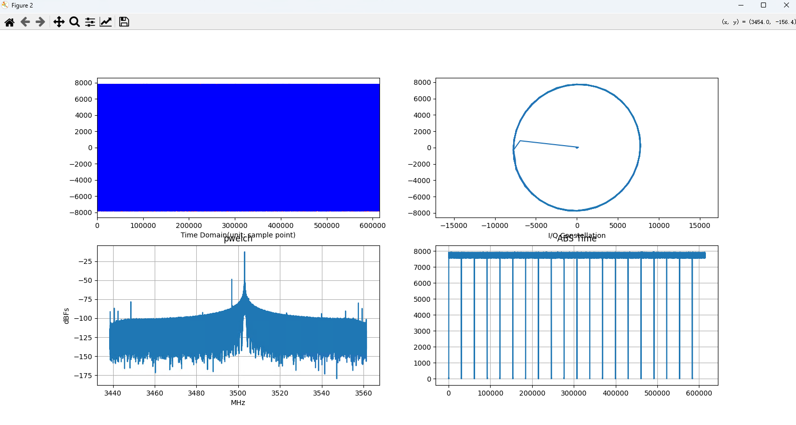
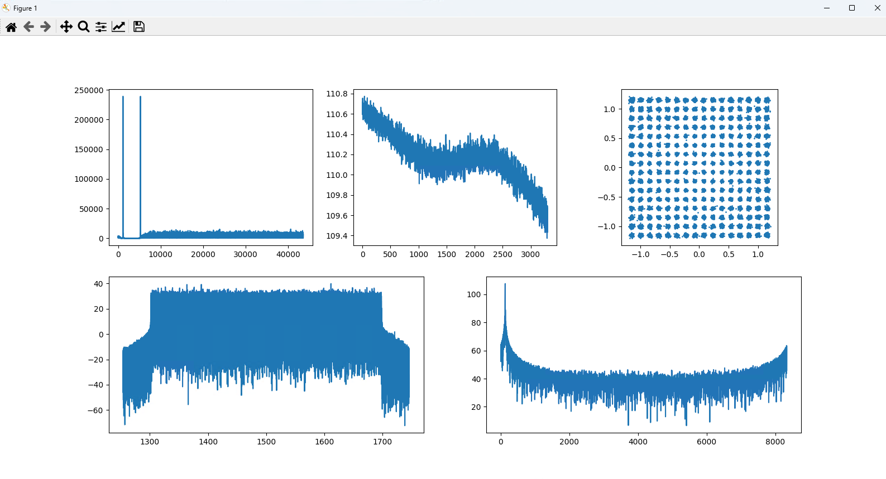

# libyunsdr Python 开发指南

本指南以 `libyunsdr-26-01-00.1.zip` 为基线，包内 SDK 版本为 **`26.00.00.1`**。使用 SWIG 绑定 `yunsdr_ss_api` 配置设备和传输 IQ16 数据。安装设备驱动、核对固件及选择 `pciex:`、`pcies:` 或 `usb3:` 时，参照 [C API 手册的驱动与构建章节](c-api.md#2-下载构建与安装)。

[Windows x64](#21-windows-x64) · [Linux 与 Spyder](#22-linux-x86-64-与-aarch64) · [首帧接收](#4-接收首帧-iq) · [射频配置](#5-配置射频与时间戳) · [循环发射](#6-生成波形与循环发射) · [测试截图](#73-测试截图) · [排查问题](#8-常见问题)

## 1. 获取 SDK 和例程

| 资料 | 内容与用途 |
| --- | --- |
| `libyunsdr-26-01-00.1.zip` | 交付源码、C 库构建工程、SWIG 接口文件 `swig/yunsdr_ss_api.i` 和 `swig/python/yunsdr_ss/example/` 下的基础脚本。ZIP 哈希见 [交付版本核对](c-api.md#1-交付版本核对) |
| `python_20260213.7z` | 另配的 Python 参考例程包，配套说明列有循环收发、单独发送、OFDM 和相位校准脚本。通过产品资料下载时，在 **Python API基础和基础程序** 中选择此包并按提示填写产品编号。该参考包未随上述 ZIP 交付，文件内容及与新版绑定的匹配关系需根据实际配套资料核对 |

从源码构建时，解压 SDK 并在包含 `CMakeLists.txt` 的根目录操作。只运行 Windows 例程时，可以使用同版的 [预编译绑定](#213-直接使用预编译包)。SDK ZIP 的 `swig/python/yunsdr_ss/old/` 保存的是历史例程及二进制文件。

## 2. 构建与导入 Python 绑定

测试基线为 Windows x64、Visual Studio 2019、CPython 3.11.9 和 SWIG 4.2.1。Python 绑定由 `ENABLE_PYTHON=ON` 和 `BUILD_PYTHON=ON` 启用。仅使用 Python 接口时，`ENABLE_EXAMPLE` 和 `ENABLE_COMLABS` 可以保持关闭。应使用构建时选中的 Python 解释器导入生成的扩展。

### 2.1 Windows x64

从源码构建可选独立的 Visual Studio 2022 Build Tools，省去完整的 Visual Studio IDE。已有匹配的预编译包时，可直接按第 2.1.3 节运行。SDK 已在 VS2019 / MSVC `v142` 上验证构建和导入，独立 VS2022 Build Tools 的验证状态见 [兼容矩阵](compatibility.md)。

#### 2.1.1 安装 Visual Studio 2022 Build Tools

1. 从 Microsoft 下载并运行 **Visual Studio 2022 Build Tools** 安装程序。在 **工作负载** 选择 **使用 C++ 的桌面开发**（Desktop development with C++）。工作负载会自动安装 MSBuild 和 C++ 核心组件。[VS2022 Build Tools 下载](https://aka.ms/vs/17/release/vs_BuildTools.exe)
2. 在右侧 **安装详细信息** 或 **单个组件** 中，保留或勾选 **MSVC v143 - VS 2022 C++ x64/x86 生成工具**，以及一套 **Windows 10 SDK** 或 **Windows 11 SDK**。使用安装程序提供的 CMake 时，再勾选 **适用于 Windows 的 C++ CMake 工具**。已有独立 CMake 3.21 或更新版本时，可省去 CMake 组件。若要复用 VS2019 基线的编译器，再勾选 **MSVC v142 - VS 2019 C++ x64/x86 生成工具（v14.29）**。本工程可省去 AddressSanitizer、测试工具、MFC、ATL、Clang 和 ARM/ARM64 工具。[Build Tools 组件清单](https://learn.microsoft.com/en-us/visualstudio/install/workload-component-id-vs-build-tools?view=vs-2022) · [CMake 生成器说明](https://cmake.org/cmake/help/latest/generator/Visual%20Studio%2017%202022.html)
3. 安装 **Windows installer (64-bit)** 版 CPython 3.11.9，保留 Python Launcher。将 SWIG 4.2.1 Windows 包解压到本地，把 `swig.exe` 所在目录加到用户 `Path`。使用独立 CMake 时，也把 `cmake.exe` 所在目录加到 `Path`。[CPython 3.11.9](https://www.python.org/downloads/release/python-3119/) · [SWIG 4.2.1](https://github.com/swig/swig/releases/tag/v4.2.1) · [CMake 下载](https://cmake.org/download/)
4. 从开始菜单打开 **Developer PowerShell for VS 2022**，检查工具版本。`cl` 此处用于显示编译器版本，构建目标架构由下一节的 `-A x64` 指定。

   ```powershell
   cmake --version
   swig -version
   py -3.11 --version
   cl
   ```

#### 2.1.2 编译安装并验证导入

将 SDK 解压到不含空格的路径，例如 `C:\YunSDR\libyunsdr-26-01-00.1`，在同一 PowerShell 进入含 `CMakeLists.txt` 的源码根目录。本交付包的 `gen_build_info` 规则会在含空格的源码路径下失败。源码 ZIP 缺少 Git 元数据时，构建日志可能提示 `not a git repository`，以 CMake 和构建命令的退出状态为准。

以下配置构建 PCIEX 和 PCIES 版。需要同时启用 USB3 时，先解压 libusb 1.0.29 的 Windows 二进制包，设置 `$enableUsb3 = $true`，并把 `$usb` 改为解压后的实际路径（其下应有 `include` 和 `VS2022`）。两种配置使用各自的构建和安装目录。[libusb 1.0.29 发布包](https://github.com/libusb/libusb/releases/tag/v1.0.29)

```powershell
$ErrorActionPreference = 'Stop'
py -3.11 -c "import sys, sysconfig; assert sys.version_info[:2] == (3, 11) and sysconfig.get_platform() == 'win-amd64'; print(sys.version)"
if ($LASTEXITCODE -ne 0) { throw 'Select x64 CPython 3.11 before building.' }
py -3.11 -m venv .venv-sdk
if ($LASTEXITCODE -ne 0) { throw 'Could not create .venv-sdk.' }
$py = (Resolve-Path .\.venv-sdk\Scripts\python.exe).Path
& $py -m pip install numpy
if ($LASTEXITCODE -ne 0) { throw 'Could not install NumPy.' }
$pythonHome = & $py -c "import sys; print(sys.base_prefix)"
$swig = (Get-Command swig.exe).Source

$generator = 'Visual Studio 17 2022'
$toolset = 'v143'
$enableUsb3 = $false
$profile = 'pciex-pcies'
$usbArgs = @('-DENABLE_USB3=OFF')
if ($enableUsb3) {
    $profile = 'pciex-pcies-usb3'
    $usb = 'C:\YunSDR\deps\libusb-1.0.29'
    $usbVs = if ($toolset -eq 'v142') { 'VS2019' } else { 'VS2022' }
    $usbHeader = (Resolve-Path -LiteralPath "$usb\include\libusb.h").Path
    $usbLib = (Resolve-Path -LiteralPath "$usb\$usbVs\MS64\dll\libusb-1.0.lib").Path
    $usbArgs = @('-DENABLE_USB3=ON', "-DLIBUSB_HEADER_FILE=$usbHeader", "-Dusb_LIBRARY=$usbLib")
}

$buildDir = "build-win64-python-$toolset-$profile"
$prefix = Join-Path (Get-Location).Path "sdk-win64-python-$toolset-$profile"
New-Item -ItemType Directory -Force -Path "$prefix\bin" | Out-Null
cmake -S . -B $buildDir -G $generator -A x64 -T $toolset `
  -DCMAKE_BUILD_TYPE=Release "-DCMAKE_INSTALL_PREFIX=$prefix" `
  "-DPython_EXECUTABLE=$py" "-DPython_ROOT_DIR=$pythonHome" "-DSWIG_EXECUTABLE=$swig" `
  -DENABLE_PYTHON=ON -DBUILD_PYTHON=ON -DENABLE_EXAMPLE=OFF -DENABLE_COMLABS=OFF `
  -DENABLE_PCIEX=ON -DENABLE_PCIES=ON -DENABLE_PCIE=OFF -DENABLE_SFP=OFF @usbArgs
if ($LASTEXITCODE -ne 0) { throw 'CMake configuration failed.' }
cmake --build $buildDir --config Release --parallel 4
if ($LASTEXITCODE -ne 0) { throw 'Release build failed.' }
cmake --install $buildDir --config Release
if ($LASTEXITCODE -ne 0) { throw 'Release installation failed.' }
if ($enableUsb3) {
    Copy-Item -LiteralPath "$prefix\lib\libusb-1.0.dll" -Destination "$prefix\bin"
}

Get-ChildItem -LiteralPath "$prefix\bin"
$env:PYTHONPATH = "$prefix\bin"
& $py -P -c "import yunsdr_ss_api as api, _yunsdr_ss_api as ext; print(api.__file__); print(ext.__file__); ticks = api.yunsdr_timeNsToTicks(500000, 30720000.0); assert ticks == 15360, ticks; print('ticks =', ticks)"
if ($LASTEXITCODE -ne 0) { throw 'Python import or tick conversion failed.' }
```

配置输出应找到目标 Python 的 `Interpreter`、`Development` 和 SWIG。`bin` 中应有 `yunsdr_ss_api.py`、`_yunsdr_ss_api.pyd`、`libyunsdr_ss.dll`，USB3 构建还应有 `libusb-1.0.dll`。验证输出应来自本次安装的 `bin`，最后一行是 `ticks = 15360`。这项检查无需连接板卡。新开终端后，从源码根目录重新设置 `$py`、`$prefix` 和 `PYTHONPATH`。

在 VS2022 Build Tools 中已加装 `v142` 时，将 `$toolset` 改成 `'v142'`，继续使用 `Visual Studio 17 2022` 生成器。使用现有 VS2019 时，在 VS2019 的 Developer PowerShell 进入新的源码解压目录，将 `$generator` 改成 `'Visual Studio 16 2019'`、`$toolset` 改成 `'v142'` 后执行同一组命令。构建目录中的 CMake 缓存绑定到首次使用的生成器和工具集。

#### 2.1.3 直接使用预编译包

在编译机完成第 2.1.2 节后，可以把同一次 Release 安装中的运行文件打成 ZIP，给另一台 Windows x64 电脑使用。若已从交付方取得同版预编译包，可直接解压验证。以下 ZIP 名称包含 SDK 版本、Python 版本、架构和启用的后端。

```powershell
$runtimeFiles = @('yunsdr_ss_api.py', '_yunsdr_ss_api.pyd', 'libyunsdr_ss.dll')
if ($enableUsb3) { $runtimeFiles += 'libusb-1.0.dll' }
$runtimeFiles = $runtimeFiles | ForEach-Object { Join-Path "$prefix\bin" $_ }
$zip = "libyunsdr-26.00.00.1-cp311-win64-$profile.zip"
Compress-Archive -LiteralPath $runtimeFiles -DestinationPath $zip -Force
```

在运行机安装 **CPython 3.11 x64** 和 **Microsoft Visual C++ v14 x64 Redistributable**。运行机只需这些运行依赖和例程所用的 Python 库。连接板卡时再按传输方式安装相应驱动。[CPython 3.11.9](https://www.python.org/downloads/release/python-3119/) · [下载 VC++ x64 运行库](https://aka.ms/vc14/vc_redist.x64.exe) · [设备驱动准备](c-api.md#231-准备编译工具和驱动)

在普通 PowerShell 执行以下命令。把 `$zip` 指向实际收到的 ZIP，使用 USB3 版时文件名应含 `usb3`。如果交付包解压后自带 `bin` 子目录，把 `PYTHONPATH` 指向实际包含 `.py`、`.pyd` 和 DLL 的目录。

```powershell
$ErrorActionPreference = 'Stop'
$zip = "$env:USERPROFILE\Downloads\libyunsdr-26.00.00.1-cp311-win64-pciex-pcies.zip"
$workDir = Join-Path $env:USERPROFILE 'YunSDR'
New-Item -ItemType Directory -Force -Path $workDir | Out-Null
Set-Location -LiteralPath $workDir
$runtime = Join-Path $workDir ([IO.Path]::GetFileNameWithoutExtension($zip))
Expand-Archive -LiteralPath $zip -DestinationPath $runtime -Force

py -3.11 -c "import sys, sysconfig; assert sys.version_info[:2] == (3, 11) and sysconfig.get_platform() == 'win-amd64'; print(sys.version)"
if ($LASTEXITCODE -ne 0) { throw 'Select x64 CPython 3.11 before running the SDK.' }
py -3.11 -m venv .venv-sdk
if ($LASTEXITCODE -ne 0) { throw 'Could not create .venv-sdk.' }
$py = (Resolve-Path .\.venv-sdk\Scripts\python.exe).Path
& $py -m pip install numpy
if ($LASTEXITCODE -ne 0) { throw 'Could not install NumPy.' }
$env:PYTHONPATH = $runtime
& $py -P -c "import yunsdr_ss_api as api, _yunsdr_ss_api as ext; print(api.__file__); print(ext.__file__); ticks = api.yunsdr_timeNsToTicks(500000, 30720000.0); assert ticks == 15360, ticks; print('ticks =', ticks)"
if ($LASTEXITCODE -ne 0) { throw 'Python import or tick conversion failed.' }
```

确认两个模块都来自解压目录，且输出 `ticks = 15360`。接下来在同一终端使用 `$py` 运行例程。若提示 `DLL load failed`，先核对 CPython 为 x64、VC++ 运行库已安装、同版 DLL 和 `_yunsdr_ss_api.pyd` 位于同一目录。USB3 版同时核对 `libusb-1.0.dll`。

### 2.2 Linux x86-64 与 AArch64

以下以 Debian/Ubuntu 和 Bash 为例。使用 pyenv 安装 CPython 3.11.9，并用这个解释器创建 `venv311`。CMake 构建绑定、pip 安装依赖和 Spyder 调试均使用这个环境。

#### 2.2.1 安装 pyenv 并生成 venv311

1. 安装编译 Python 和 SDK 所需的工具与开发库。

   ```bash
   sudo apt update
   sudo apt install build-essential cmake swig git curl pkg-config \
     libssl-dev zlib1g-dev libbz2-dev libreadline-dev libsqlite3-dev \
     libncurses-dev xz-utils tk-dev libffi-dev liblzma-dev
   ```

2. 将 pyenv 安装到用户目录并初始化当前 Bash。已有 pyenv 时使用现有安装目录，可跳过克隆。希望每次打开 Bash 都能直接使用 pyenv 时，将环境变量和初始化命令加入 `~/.bashrc`。[pyenv 安装说明](https://github.com/pyenv/pyenv#installation)

   ```bash
   export PYENV_ROOT="$HOME/.pyenv"
   if [ ! -x "$PYENV_ROOT/bin/pyenv" ]; then
     git clone https://github.com/pyenv/pyenv.git "$PYENV_ROOT"
   fi
   export PATH="$PYENV_ROOT/bin:$PATH"
   eval "$(pyenv init - bash)"
   pyenv --version
   ```

3. 安装 CPython 3.11.9 并用它创建虚拟环境。`PYENV_VERSION=3.11.9` 只选择创建环境这一条命令所用的解释器。默认存放在 `~/python_envs/venv311`。若使用已预置的可写数据目录，可将 `venv_dir` 改为 `/data/python_envs/venv311`。

   ```bash
   PYTHON_CONFIGURE_OPTS="--enable-shared" pyenv install -s 3.11.9
   venv_dir="$HOME/python_envs/venv311"
   mkdir -p "$(dirname "$venv_dir")"
   PYENV_VERSION=3.11.9 pyenv exec python -m venv "$venv_dir"
   source "$venv_dir/bin/activate"
   py="$VIRTUAL_ENV/bin/python"
   "$py" --version
   "$py" -c 'import sys; print(sys.executable); print(sys.base_prefix)'
   ```

   输出应显示 `Python 3.11.9`、`venv311/bin/python` 和 pyenv 安装的 3.11.9 基础目录。若复用已有 `venv311`，先用这两项检查确认其基础版本。

4. 在 `venv311` 中通过 pip 安装 Spyder 和例程依赖。使用该环境的解释器调用 pip，可确认库安装在同一虚拟环境中。Spyder 所需的 Qt 和内核依赖由 pip 一并解析。[Spyder pip 安装说明](https://docs.spyder-ide.org/current/installation.html#using-pip)

   ```bash
   "$py" -m pip install --upgrade pip
   "$py" -m pip install spyder numpy matplotlib scipy PyQt5 ModulationPy
   "$py" -m pip check
   "$py" -m pip show spyder spyder-kernels
   ```

#### 2.2.2 用 venv311 构建并导入绑定

进入含 `CMakeLists.txt` 的 SDK 源码根目录。AArch64 使用匹配主机架构的配套驱动，CMake 会优先查找 `lib/ARM64/` 的静态依赖。下面指定 `venv311` 的解释器以及对应的 pyenv 基础目录，使 CMake 查找同一套开发头文件和库。

```bash
source "$HOME/python_envs/venv311/bin/activate"
py="$VIRTUAL_ENV/bin/python"
python_home="$("$py" -c 'import sys; print(sys.base_prefix)')"
build_dir="$PWD/build-linux-python"
cmake -S . -B "$build_dir" -DCMAKE_BUILD_TYPE=Release \
  -DPython_EXECUTABLE="$py" -DPython_ROOT_DIR="$python_home" \
  -DENABLE_PYTHON=ON -DBUILD_PYTHON=ON \
  -DENABLE_EXAMPLE=OFF -DENABLE_COMLABS=OFF -DENABLE_USB3=OFF \
  -DENABLE_PCIEX=ON -DENABLE_PCIES=ON -DENABLE_PCIE=OFF -DENABLE_SFP=OFF
cmake --build "$build_dir" --parallel 4
export PYTHONPATH="$build_dir/lib"
export LD_LIBRARY_PATH="$build_dir/lib"
ldd "$build_dir/lib/_yunsdr_ss_api.so"
"$py" -c 'import yunsdr_ss_api as api, _yunsdr_ss_api as ext; print(api.__file__); print(ext.__file__)'
```

若虚拟环境建在其他位置，请同步替换 `source` 行。检查 CMake 选中的 Python 为 3.11.9 且找到 `Interpreter` 和 `Development`。本包将生成的 `yunsdr_ss_api.py` 和 `_yunsdr_ss_api.so` 复制到 `build-linux-python/lib/`，与 `libyunsdr_ss.so` 一起使用。`ldd` 应解析到该构建的 C 库及系统依赖。启用 USB3 时安装 `libusb-1.0-0-dev`，把 `ENABLE_USB3` 改为 `ON` 并使用独立构建目录。

#### 2.2.3 从 venv311 启动 Spyder 调试

1. 在 Linux 图形桌面的终端中激活 `venv311`，从 SDK 源码根目录设置本次构建的库路径，然后从虚拟环境启动 Spyder。使用 USB3 构建或自定义目录时，替换 `build_dir`。

   ```bash
   source "$HOME/python_envs/venv311/bin/activate"
   build_dir="$PWD/build-linux-python"
   export PYTHONPATH="$build_dir/lib"
   export LD_LIBRARY_PATH="$build_dir/lib"
   "$VIRTUAL_ENV/bin/spyder"
   ```

2. 在 Spyder 的 IPython 控制台检查解释器和绑定路径。解释器应位于 `venv311/bin/`，两个模块应来自 `build-linux-python/lib/`。若当前内核使用了其他解释器，可在「首选项 → Python 解释器」选择 `venv311/bin/python`，再重启内核。

   ```python
   import sys
   import yunsdr_ss_api as api
   import _yunsdr_ss_api as ext

   print(sys.executable)
   print(api.__file__)
   print(ext.__file__)
   ```

3. 在 Spyder 中打开例程，将工作目录设为该脚本和输入文件所在目录。先运行配套的 `test_cofdm.py` 做离线检查。可在 IPython 控制台的绘图首选项选择 Qt 后端并重启内核，让 Matplotlib 打开独立图窗。典型图窗见 [测试截图](#73-测试截图)。
4. 调试时，在行号栏设置断点，从「调试」菜单运行当前文件，在变量浏览器中检查 `shape`、`dtype`、掩码和返回点数。联机调试前按 [驱动安装](c-api.md#241-准备工具解压源码与核对设备) 配置设备权限，在当前用户的图形会话启动 Spyder。[Spyder 调试说明](https://docs.spyder-ide.org/current/panes/debugging.html)

Linux 原生编译、Spyder 图形调试和联机验证状态见 [兼容矩阵](compatibility.md)。AArch64 上安装 Spyder 还需确认发行版及所选 Python 版本有可用的 Qt 依赖。

### 2.3 Windows Spyder 与依赖

命令行即可运行本指南。使用 Spyder 时，从设置好 `PYTHONPATH` 的终端启动，在「首选项 → Python 解释器」选择 `.venv-sdk` 的 `python.exe`。按 Spyder 控制台提示的版本范围，用同一解释器安装 `spyder-kernels` 并重启内核。需要交互式图窗时，在 IPython 控制台的绘图设置里选择可用的 Qt 后端。用 `import yunsdr_ss_api` 检查加载的绑定。[Spyder 环境配置说明](https://docs.spyder-ide.org/current/faq.html)

本指南的接收和波形生成示例只需 NumPy。运行配套的波形分析与绘图脚本时，按用途在虚拟环境安装依赖，例如运行 `& $py -m pip install matplotlib scipy PyQt5 ModulationPy`。

## 3. Python 调用约定

| 调用 | 行为 |
| --- | --- |
| `yunsdr_open_device(url)` / `yunsdr_close_device(dev)` | 打开成功返回设备句柄，失败返回 `None`。应用在 `finally` 中关闭有效句柄 |
| `yunsdr_get_model_version(dev)`、`yunsdr_get_firmware_version(dev)` | 解包为 `rc, value`。固件值的低 16 位是 FPGA，高 16 位是 ARM |
| `yunsdr_read_timestamp(dev, dev_id)` | 解包为 `rc, tick`。时间基准由当前设备配置决定 |
| `yunsdr_read_samples_multiport_Python(dev, buf, count, mask, 0)` | 解包为 `nread, tick`，I/Q 写入 `buf`。最后一个参数是时间戳的输入初值，常规接收用 `0` |
| `yunsdr_write_samples_multiport_Python(dev, buf, count, mask, tick, flags)` | 返回写入点数或负值，普通示例使用 `flags=0`。使用定时发射时，`tick` 取设备域的调度时间 |

查询接口有独立的 SWIG 签名，例如该版的 `yunsdr_get_device_configuration(dev, OUTPUT)` 仍需要 `DEV_CFG` 指针参数。以本次生成的 `yunsdr_ss_api.py` 的声明为准。频率、采样率、掩码和样点数传普通 Python `int`，例如 `int(30.72e6)`。

普通 IQ16 缓冲区使用 C 连续的 `np.int16` 数组，形状为 `(K, N, 2)`，其中 `K` 是掩码置位数，`N` 是传给 API 的每路复数样点数。最后一维依次是 I、Q。通道按掩码位升序紧密排列，例如 `0x5` 对应本地第 1、3 路，数组的第 0、1 行分别对应这两路。每路需要 `4N` 字节。RX 数组必须可写。用户需检查缓冲区长度、连续性和格式，当前包装层将 Python 缓冲区的地址直接传给 C。

本版 buffer typemap 取得 `Py_buffer` 后未调用 `PyBuffer_Release`。下面的首帧及有限次收发用于上手验证。需要长期连续采集时，先在对应 SDK 版本处理包装层的缓冲区生命周期问题并验证内存占用。

## 4. 接收首帧 IQ

先用 `-h` 或导入检查验证主机环境，再连接设备。下面的程序读取型号和固件，沿用设备已经配置好的射频参数，通过普通多路 API 采集本地第 1 路。将代码保存为 `rx_once.py`。初次运行用已知输入信号，`--count` 采用设备支持的每路块长。

```python
import argparse
from pathlib import Path

import numpy as np
import yunsdr_ss_api as api


def check(rc, name):
    if rc < 0:
        raise RuntimeError(f"{name} failed: {rc}")


def main():
    parser = argparse.ArgumentParser(description="Read one IQ16 block from RX1.")
    parser.add_argument("url", help="e.g. pciex:0")
    parser.add_argument("--count", type=int, default=30720)
    parser.add_argument("--output", type=Path, default=Path("rx_ch1.iq16"))
    args = parser.parse_args()
    backend, separator, address = args.url.partition(":")
    if (
        not separator
        or not address
        or backend not in {"pciex", "pcies", "usb3"}
        or len(args.url.encode("utf-8")) >= 128
    ):
        parser.error("use one valid SDK device URL")
    if not 0 < args.count <= 0x7FFFFFFF:
        parser.error("--count must be a positive 32-bit signed integer")

    dev = api.yunsdr_open_device(args.url)
    if dev is None:
        raise RuntimeError(f"cannot open {args.url}")
    try:
        rc, model = api.yunsdr_get_model_version(dev)
        check(rc, "read model")
        rc, version = api.yunsdr_get_firmware_version(dev)
        check(rc, "read firmware")
        print(f"model=0x{model:08x}, firmware=0x{version:08x}")

        iq = np.zeros((1, args.count, 2), dtype=np.int16)
        nread, tick = api.yunsdr_read_samples_multiport_Python(
            dev, iq, args.count, 0x1, 0
        )
        if nread != args.count:
            raise RuntimeError(f"RX returned {nread}, expected {args.count}")
        with args.output.open("xb") as output:
            iq.astype("<i2", copy=False).tofile(output)
        print(f"samples={nread}, tick={tick}, file={args.output}")
    finally:
        api.yunsdr_close_device(dev)


if __name__ == "__main__":
    main()
```

在步骤 2 设置好路径的终端运行。按机型改用 `pcies:0.0` 或 `usb3:0` 时，确认加载的是已启用该后端的构建。若输出文件已存在，改用另一个文件名或先移走旧文件。

```powershell
& $py .\rx_once.py 'pciex:0' --count 30720 --output rx_ch1.iq16
(Get-Item -LiteralPath .\rx_ch1.iq16).Length
```

```bash
"$py" ./rx_once.py 'pciex:0' --count 30720 --output rx_ch1.iq16
wc -c < rx_ch1.iq16
```

成功时文件为 `30720 × 4 = 122880` 字节。用下面的方式重建复数样点并核对已知输入。文件为小端的 `I0 Q0 I1 Q1 …`，采样率、频点和 tick 需随测试记录保存。

```python
import numpy as np

raw = np.fromfile("rx_ch1.iq16", dtype="<i2").reshape(-1, 2)
signal = raw[:, 0].astype(np.float32) + 1j * raw[:, 1].astype(np.float32)
```

## 5. 配置射频与时间戳

在接收代码的 `try` 内、申请缓冲区之前，可加上如下配置。`rf_id=0` 是例程的首组 RF 控制目标，机型的 RF 组、组内通道和掩码对应关系见配套接口说明。频率、采样率和增益为示例值，运行前替换为设备支持的配置。

```python
rf_id = 0
sample_rate = 30_720_000
center_hz = 2_400_000_000
check(api.yunsdr_set_rx_sampling_freq(dev, rf_id, sample_rate), "set RX sample rate")
check(api.yunsdr_set_rx_lo_freq(dev, rf_id, center_hz), "set RX LO")
check(api.yunsdr_set_rx1_gain_control_mode(dev, rf_id, api.RF_GAIN_MGC), "set RX gain mode")
check(api.yunsdr_set_rx1_rf_gain(dev, rf_id, 5), "set RX1 gain")
rc, actual_hz = api.yunsdr_get_rx_lo_freq(dev, rf_id)
check(rc, "read RX LO")
print(f"RX LO: {actual_hz} Hz")
```

- 发射路径用 `yunsdr_set_tx_sampling_freq`、`yunsdr_set_tx_lo_freq` 和 `yunsdr_set_tx1_attenuation` 对应配置。衰减单位为 mdB，例如 `30000` 等于 30 dB。使用共享 LO、共用采样率或可调带宽的机型时，按实际 RF 控制组写入并读取设备支持的查询项。
- 如果固件及后端支持用连接串调整接收帧长，PCIEX 示例可写成 `pciex:0,nsamples_recv_frame:7680`。此时 `--count 30720` 是每路四帧的数据量。以实际后端允许的帧长及对齐要求为准。
- 使用定时收发时，按设备配置参考时钟和 PPS，再调用 `yunsdr_enable_timestamp`，用 `yunsdr_read_timestamp` 获取当前 tick。转换函数接受计数器速率（tick/s）。例如计数器速率为 30.72 MHz 时，`yunsdr_timeNsToTicks(500000, 30720000.0)` 返回 `15360`。多通道或多设备需实测计数器是否同起点，并通过回环确认触发与链路延迟。
- RFSoC 的 ADC 校准、ADRV90xx 快锁及设备内数字回环属于机型扩展。参考脚本中的扩展命令编号、参数、RF 缓存大小和最大块长，须核对对应固件后再使用。

## 6. 生成波形与循环发射

参考例程的工作顺序是准备逐通道波形、向支持循环发送的设备写入一个块、启动重复发射、用 RX 掩码取样，再停止发射并释放设备。初次联机用单通道和带衰减器的有线回环，按设备允许的功率及输入范围配置。设备须支持所选的循环模式。

### 6.1 准备 IQ16 波形

下例为相位连续重复的单音，一个块内含整数个周期。数组按 `(通道, 样点, I/Q)` 排列。自研 OFDM 输入或文件输入也按此布局准备，各通道的 `count` 相同，短通道在构建缓冲区时补零。

```python
count = 30720
period = 40
phase = 2.0 * np.pi * np.arange(count) / period
tx = np.empty((1, count, 2), dtype=np.int16)
tx[0, :, 0] = np.rint(12000 * np.cos(phase)).astype(np.int16)
tx[0, :, 1] = np.rint(12000 * np.sin(phase)).astype(np.int16)
```

归一化复数输入应先按所需幅度缩放、取整并裁剪到 `[-32768, 32767]`，再转换成 `int16`。文件输入使用 `np.fromfile(path, dtype="<i2")`，检查元素数可被 2 整除且每路点数符合配置。

### 6.2 启动周期发送并读取

在有效句柄和射频已配置、输入和输出均准备好的情况下使用下面的调用。本包随附的 `get_dataset.py` 采用 `0 → 1 → 写入 → 3` 的循环模式顺序。对应固件要求的预读、时间戳复位方式或缓存配置按实际设备流程执行。PCIES 与 PCIEX 的处理可以不同。检查实际写入点数后再启动。

```python
dev_id = 0
tx_mask = 0x1
rx_mask = 0x1
rx = np.zeros((1, count, 2), dtype=np.int16)
check(api.yunsdr_tx_cyclic_enable(dev, dev_id, 0), "stop existing loop")
try:
    check(api.yunsdr_tx_cyclic_enable(dev, dev_id, 1), "prepare loop")
    nwrite = api.yunsdr_write_samples_multiport_Python(
        dev, tx, count, tx_mask, 0, 0
    )
    if nwrite != count:
        raise RuntimeError(f"TX returned {nwrite}, expected {count}")
    check(api.yunsdr_tx_cyclic_enable(dev, dev_id, 3), "start loop")
    nread, tick = api.yunsdr_read_samples_multiport_Python(
        dev, rx, count, rx_mask, 0
    )
    if nread != count:
        raise RuntimeError(f"RX returned {nread}, expected {count}")
    print(f"received {nread} IQ samples at tick {tick}")
finally:
    stop_rc = api.yunsdr_tx_cyclic_enable(dev, dev_id, 0)
    if stop_rc < 0:
        print(f"stop loop failed: {stop_rc}")
```

结合上一节的外层 `finally` 关闭设备。普通接收返回的 tick 用于记录块起点。即使计数器已同步，滤波、转换和射频链路也可能带来固定时延，需用已知波形做回环测量。

## 7. 分析数据与相位校准

| 任务 | 操作 |
| --- | --- |
| 单音检查 | 从 IQ16 得到复数数组，逐路检查时域、散点及频谱。FFT 频轴由实际采样率生成，转换为绝对频率时再加 RX 中心频率。记录主峰位置和相对幅度 |
| OFDM 环境验证 | 另配参考包中进入含 `test_cofdm.py`、`cofdm_tx.py`、`cofdm_rx.py` 的目录，安装其依赖，再用当前 Python 运行 `test_cofdm.py`。验证调制、同步及解调输出，检查频偏与 EVM 是否为有限值。该离线检查无需打开设备 |
| 宽带收发 | 在参考包的顶层脚本选择宽带波形，设置相同的 FFT 长度、子载波数、调制阶数及采样率，再核对捕获过渡段、频率估计和 EVM。信号生成与解调参数随参考包而定 |
| 相位校准 | 将同一个已知单音经功分器送入待校 RX 通道。在目标频点测量各路相对参考通道的相位差，按该机型的系数约定生成校准文件。写入后重新采集同源信号验证相位差。每个使用频点分别校准，断电后的保留方式随固件确认 |

### 7.1 检查单音与通道相位

下例用 6.2 中的 `rx` 和设定的接收采样率 `sample_rate` 估计基带主峰。在各通道同步接收同一个离散单音时，取参考通道的主峰所在 FFT 格点，比较各路的幅度和相位。若信号很弱或存在多个强分量，先核实所取 FFT 格点。

```python
samples = rx[:, :, 0].astype(np.float64) + 1j * rx[:, :, 1].astype(np.float64)
window = np.hanning(samples.shape[1])
spectrum = np.fft.fft(samples * window, axis=1)
peak_bin = int(np.argmax(np.abs(spectrum[0])))
offset_hz = np.fft.fftfreq(samples.shape[1], d=1.0 / sample_rate)[peak_bin]
peak = spectrum[:, peak_bin]
scale = abs(peak) / (window.sum() * 32768)
amplitude_dbfs = 20 * np.log10(np.maximum(scale, np.finfo(float).tiny))
phase_deg = np.angle(peak * np.conj(peak[0]), deg=True)
print(offset_hz, amplitude_dbfs, phase_deg)
```

### 7.2 运行配套例程

另配包的主要入口是 `yunsdr_tx_rxcyclic.py`（循环收发）、`yunsdr_tx.py`（独立发送）、`test_cofdm.py`（离线 OFDM）、`coeff_calc.py` / `config_coeff.py`（生成和应用相位补偿）、`disable_coeff.py`（关闭或清除补偿）及 `calib_from_gps.py`（设备支持时的参考校准）。先用对应参考包的模块和脚本组合运行。在需要使用本指南编译的 SWIG 绑定时，确认脚本目录中没有会覆盖导入路径的同名旧 `.py`、`.pyd` 或 `.so`，用 `api.__file__` 验证。

解压例程包并切换到包含 `test_cofdm.py` 的目录，保留第 2 节设定的 Python 环境及绝对路径变量。在 Windows 运行 `& $py .\test_cofdm.py`，在 Linux 运行 `"$py" ./test_cofdm.py`。离线验证通过后，再在顶层脚本中设置设备地址、射频类型、目标频点、采样率、每路块长和通道掩码，按同样方式运行所需的入口脚本。

使用配套脚本校准接收相位时，在循环收发例程中选择单音并将相位差保存到 `data/`。在 `coeff_calc.py` 设定同一频点，生成相应的补偿文件。随后在 `config_coeff.py` 选择该频点的两份系数文件并运行。重新收取同源单音，验证与参考通道的相位差，再把已验证的参数纳入应用启动流程。

交付 SDK 的 `get_txbuf.py`、`gen_tone_data.py` 和 `disp_rx_data.py` 可用来阅读基础波形与绘图流程。该 ZIP 内的 `get_rxbuf.py` 会删除当前目录的 `.dat`，对 `yunsdr_read_samples_multiport_Matlab` 的调用还少了本版生成接口要求的时间戳实参。使用本指南的首帧代码作为联机起点。

### 7.3 测试截图

以下截图来自 YunSDR 配套 Python 开发指南的原测试。图中波形和读数对应原测试配置。用 `venv311` 和 Spyder 运行时，可按相应图窗检查相关峰、星座分布、频谱主峰及通道相位。实测记录应注明设备、采样率、中心频率和参考时钟。

#### 离线 OFDM

运行 `test_cofdm.py` 后检查相关峰、解调星座图和占用频带。这一步在主机完成，可用于确认 Python 依赖和绘图环境。


#### 单音和宽带收发

单音测试查看 I/Q 轨迹和频谱主峰，并与设定频点及单音偏移核对。



宽带测试检查同步峰、解调星座分布、占用频带及控制台的频偏和 EVM 输出。



#### 相位校准后的结果

单音测试用同源输入比较各通道主峰处的相位读数。应用补偿后再次采集，按项目允许的残余相位差验收。


宽带测试检查各路解调结果，并结合通道相位、频偏与 EVM 记录校准后的表现。


## 8. 常见问题

| 现象 | 排查方法 |
| --- | --- |
| `No module named 'yunsdr_ss_api'` | 检查 `PYTHONPATH` 和解释器。包装文件 `yunsdr_ss_api.py` 应与生成的扩展一同存在 |
| Windows `DLL load failed` 或 Linux `cannot open shared object file` | 检查 Python 版本和位数、生成扩展的路径与同版 `libyunsdr_ss`。USB3 检查 libusb 动态库。Linux 在测试终端用 `ldd` 核对 |
| Spyder 中的解释器或 SDK 路径与终端不同 | 从激活 `venv311` 且设置好库路径的终端启动，核对 `sys.executable` 和 `api.__file__`。如果调整了解释器或环境变量，重启 Spyder 或其内核后复查 |
| Linux 的 Spyder 图窗打不开 | 检查当前会话是否有图形桌面，再核对 Qt 图形后端选择。若启动终端提示 Qt 平台插件加载失败，按报错检查发行版的系统图形依赖 |
| `None` 句柄或设备打开失败 | 核对地址前缀、CMake 实际启用的后端、主机驱动和访问权限。先用 [基础 C 测试](c-api.md#43-基础测试程序) 验证同一设备 |
| 样点数异常、通道错位 | 检查掩码、数组的 `int16` 类型与连续性，以及每路点数。`0x5` 需要两个连续的通道块，按掩码置位顺序存放 |
| 频谱频点或相位不符 | 确认 RX 实际采样率、I/Q 顺序、中心频率、参考时钟和同源回环。检查信号是否过载或输入太弱 |
