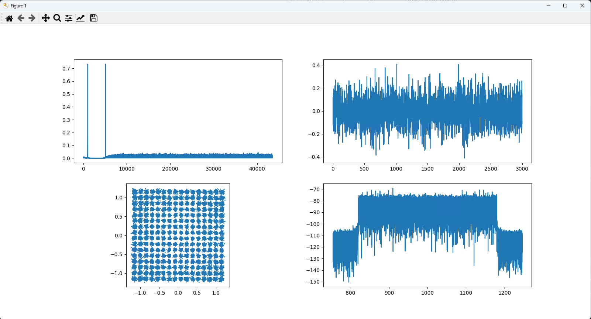
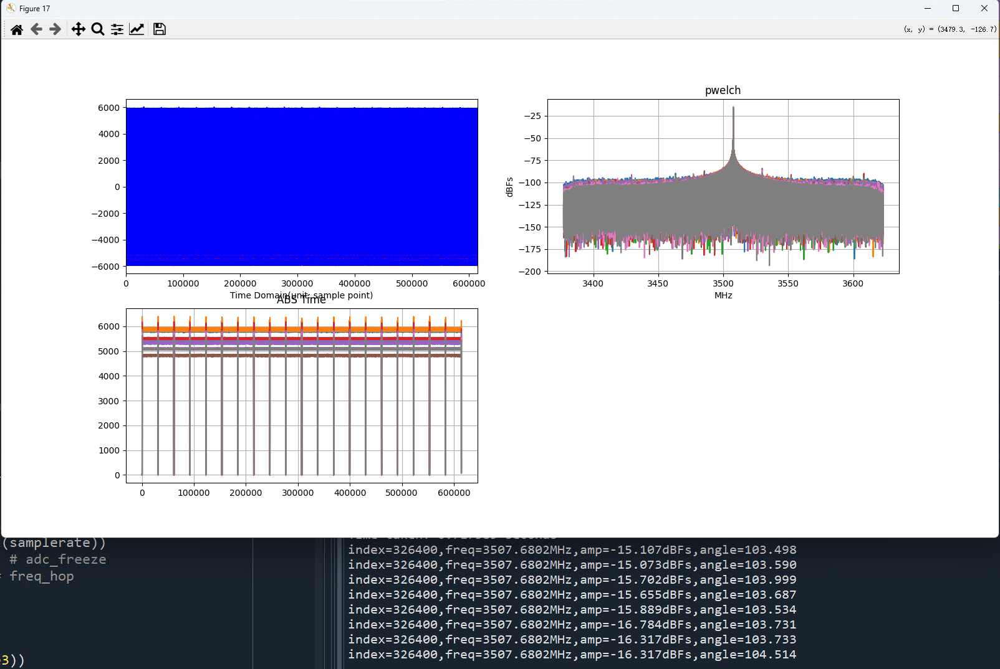
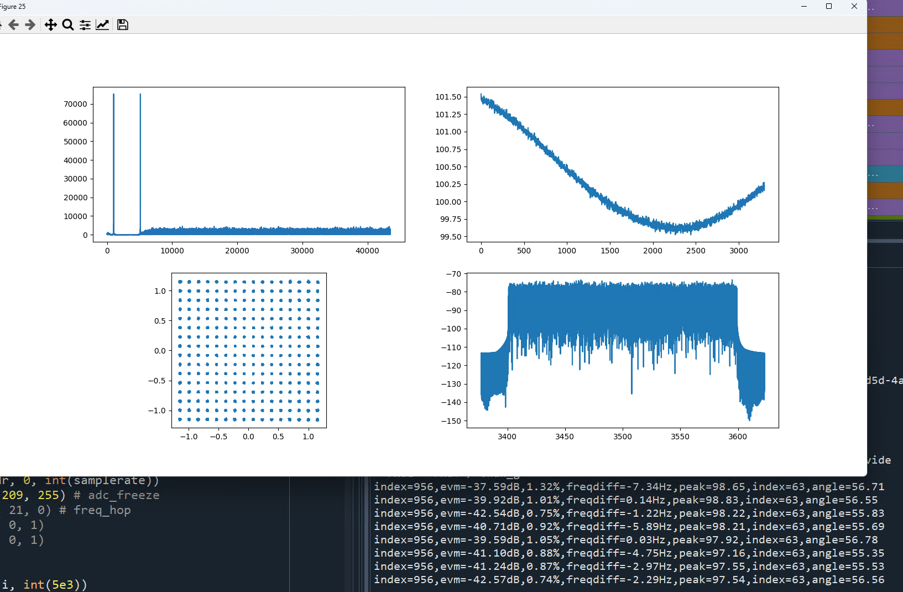

# libyunsdr Python 开发指南

本指南以 SDK **`26.00.00.1`** 为基线。使用随 Python 例程交付的预编译 `yunsdr_ss_api` 配置设备并收发 IQ16 数据。[C API 手册中的设备驱动与后端说明](c-api.md#2-下载构建与安装)

[Windows x64](#21-windows-x64) · [Linux x86-64 与 AArch64](#22-linux-x86-64-与-aarch64) · [Windows Spyder](#213-安装并启动-spyder) · [PowerShell 运行例程](#214-在-powershell-运行-python-例程) · [Linux Spyder](#223-从-venv311-启动-spyder-调试) · [首帧接收](#4-接收首帧-iq) · [循环发射](#6-生成波形与循环发射) · [测试截图](#73-测试截图) · [排查问题](#8-常见问题)

## 1. 获取预编译绑定和例程

从配套资料取得 Python 例程及预编译绑定。通过产品资料下载时，在 **Python API基础和基础程序** 中选择对应产品的资料，按提示填写产品编号。`python_20260213.7z` 是配套例程包示例，含 OFDM、循环收发和相位校准等脚本。实际交付文件与支持组合以收到的包为准。

| 选择项 | 如何核对 |
| --- | --- |
| SDK 与 Python 版本 | 选与例程配套的 SDK 版本。`cp311` 对应 CPython 3.11，`cp312` 对应 CPython 3.12。以下以 `cp311` 为例，其他版本按包标识选择解释器 |
| 系统与架构 | 区分 Windows x64、Linux x86-64 和 Linux AArch64。Linux 同时核对包标注的发行版或系统运行库要求 |
| 传输后端 | 核对包启用的 PCIEX、PCIES 或 USB3，按机型安装对应驱动 |
| 配套文件 | 从同一个包取 Python 封装文件、扩展和动态库，置于脚本目录。切换版本时先移走同名旧文件 |

<a name="214-使用-mingw-w64-和-swig-构建-python-绑定"></a>

离线 OFDM 例程 `test_cofdm.py` 只需要 Python 依赖。收发例程还需要对应的预编译绑定、动态库和设备驱动。制作预编译包的步骤见 [C API 手册](c-api.md#25-使用-swig-构建-python-绑定)。

<a name="2-构建与导入-python-绑定"></a>

## 2. 使用预编译 Python 绑定

### 2.1 Windows x64

<a name="23-windows-虚拟环境与-spyder"></a>
<a name="231-创建或复用-venv-sdk"></a>

#### 2.1.1 创建或复用 .venv-sdk

安装与包匹配的 64 位 CPython，并保留 Python Launcher。把第一行路径改成实际例程目录。已有匹配的 `.venv-sdk` 时，跳过创建环境的命令。后续用相对路径启动，无需激活。[CPython 3.11.9 x64 安装包](https://www.python.org/downloads/release/python-3119/)

```powershell
Set-Location -LiteralPath 'C:\YunSDR\python_20260213'
py -3.11 -m venv .venv-sdk
& .\.venv-sdk\Scripts\python.exe -m pip install numpy
```

<a name="213-直接使用预编译包"></a>

<a name="212-解压预编译库并验证导入"></a>

#### 2.1.2 手动复制预编译库

从与 CPython 版本和架构匹配的预编译包中，将以下文件复制到要运行的 `.py` 脚本所在目录，例如 `C:\YunSDR\python_20260213`。

- `yunsdr_ss_api.py`
- `_yunsdr_ss_api.pyd`
- `libyunsdr_ss.dll`
- `libusb-1.0.dll`（USB3 版需要）

文件随例程交付且已放在脚本旁时，直接用第 2.1.3 或 2.1.4 节的方式运行。使用 MSVC 预编译包时，按交付说明安装 Microsoft Visual C++ v14 x64 运行库。[VC++ x64 运行库](https://aka.ms/vc14/vc_redist.x64.exe)

<a name="232-安装并启动-spyder"></a>

#### 2.1.3 安装并启动 Spyder

在例程目录执行。首次使用时运行第一行安装 Spyder 和 `test_cofdm.py` 所需的库。第二行打开一个新实例，将工作目录设为当前目录。[Spyder 的 pip 安装说明](https://docs.spyder-ide.org/current/installation.html#using-pip)

```powershell
& .\.venv-sdk\Scripts\python.exe -m pip install spyder numpy matplotlib ModulationPy
& .\.venv-sdk\Scripts\spyder.exe --new-instance --workdir . .\test_cofdm.py
```

在编辑器按 **F5** 运行，或设置断点后从「调试」菜单启动。调试调用 libyunsdr 的程序前，先按第 2.1.2 节把库文件复制到脚本旁。若控制台使用了其他解释器，在「首选项 → Python 解释器」选实际的 `.venv-sdk\Scripts\python.exe`，然后重启内核。[Spyder 解释器配置](https://docs.spyder-ide.org/current/faq.html)

<a name="233-在-powershell-运行-python-例程"></a>

#### 2.1.4 在 PowerShell 运行 Python 例程

在 `.venv-sdk` 和脚本所在目录运行。首次使用时安装例程依赖。

```powershell
& .\.venv-sdk\Scripts\python.exe -m pip install numpy matplotlib ModulationPy
& .\.venv-sdk\Scripts\python.exe .\test_cofdm.py
```

`test_cofdm.py` 是离线仿真。脚本会在当前目录写入或覆盖 `rf_data.bin`，关闭 Matplotlib 图窗后，终端会打印 EVM 和频偏等结果。运行联机例程时，先按第 2.1.2 节放好库，再替换命令中的脚本名。[OFDM 结果示例](#73-测试截图)

### 2.2 Linux x86-64 与 AArch64

以下以 Debian/Ubuntu 和 Bash 为例。用 `uname -m` 核对架构。以下例程目录为 `$HOME/python_20260213`，运行前按实际路径修改。

#### 2.2.1 安装 pyenv 并生成 venv311

1. 使用 pyenv 安装 CPython 时，先准备 Python 自身所需的构建依赖。已装有匹配的 CPython 3.11 时，可直接在例程目录执行 `python3.11 -m venv venv311`，再安装例程依赖。

   ```bash
   sudo apt update
   sudo apt install build-essential git curl \
     libssl-dev zlib1g-dev libbz2-dev libreadline-dev libsqlite3-dev \
     libncurses-dev xz-utils tk-dev libffi-dev liblzma-dev
   ```

2. 将 pyenv 安装到用户目录。已有 pyenv 时，跳过克隆并按实际位置设置 `PYENV_ROOT`。[pyenv 安装说明](https://github.com/pyenv/pyenv#installation)

   ```bash
   export PYENV_ROOT="$HOME/.pyenv"
   git clone https://github.com/pyenv/pyenv.git "$PYENV_ROOT"
   export PATH="$PYENV_ROOT/bin:$PATH"
   ```

3. 在例程目录创建 `venv311`。收到其他 CPython 版本的绑定时，替换下面的 Python 版本，并用对应环境的路径运行后续命令。

   ```bash
   cd "$HOME/python_20260213"
   pyenv install -s 3.11.9
   PYENV_VERSION=3.11.9 pyenv exec python -m venv venv311
   ./venv311/bin/python -m pip install numpy matplotlib ModulationPy
   ```

#### 2.2.2 放置预编译库并验证导入

在例程目录，把同一个预编译包中的 `yunsdr_ss_api.py`、`_yunsdr_ss_api.so` 和 `libyunsdr_ss.so` 放到脚本旁。收到独立的 `.tar.gz` 时，可用下面的命令解压。把文件名换成实际交付包，AArch64 使用对应架构的文件。

```bash
tar -xzf "$HOME/libyunsdr-26.00.00.1-cp311-linux-x86_64-pciex-pcies-usb3.tar.gz" -C .
```

USB3 包依赖系统 libusb 时，在 Debian/Ubuntu 上安装 `libusb-1.0-0`。在当前终端设置动态库搜索路径，再检查依赖与导入。`ldd` 应能找到同目录的 `libyunsdr_ss.so`，导入检查应显示当前目录的两个模块路径并输出 `ticks = 15360`。

```bash
export LD_LIBRARY_PATH="$PWD${LD_LIBRARY_PATH:+:$LD_LIBRARY_PATH}"
ldd ./_yunsdr_ss_api.so
./venv311/bin/python -E -c "import yunsdr_ss_api as api, _yunsdr_ss_api as ext; print(api.__file__, ext.__file__, sep='\n'); print('ticks =', api.yunsdr_timeNsToTicks(500000, 30720000.0))"
```

#### 2.2.3 从 venv311 启动 Spyder 调试

在 Linux 图形桌面的终端进入例程目录。首次使用时安装 Spyder，再启动并打开例程。[Spyder 的 pip 安装说明](https://docs.spyder-ide.org/current/installation.html#using-pip)

```bash
./venv311/bin/python -m pip install spyder
./venv311/bin/spyder --new-instance --workdir . ./test_cofdm.py
```

在编辑器按 **F5** 运行。在行号栏设置断点后，从「调试」菜单启动调试。若内核选择了其他解释器，在「首选项 → Python 解释器」选择 `venv311/bin/python` 的实际路径，再重启内核。其他例程用到 SciPy 时，执行 `./venv311/bin/python -m pip install scipy`。[Spyder 调试说明](https://docs.spyder-ide.org/current/panes/debugging.html)

调试联机例程时，先按第 2.2.2 节放置库文件并设置 `LD_LIBRARY_PATH`，再在同一终端启动 Spyder。AArch64 图形调试需要有匹配的 Qt 依赖。[Linux 驱动和设备访问](c-api.md#241-准备工具解压源码与核对设备)

#### 2.2.4 在 Bash 运行 Python 例程

在 `venv311` 和脚本所在目录直接执行。离线 OFDM 无需加载 SDK 或连接设备。运行联机例程时，先按第 2.2.2 节准备绑定和库路径，再替换脚本名。

```bash
./venv311/bin/python ./test_cofdm.py
```

## 3. Python 调用约定

| 调用 | 行为 |
| --- | --- |
| `yunsdr_open_device(url)` / `yunsdr_close_device(dev)` | 打开成功返回设备句柄，失败返回 `None`。应用在 `finally` 中关闭有效句柄 |
| `yunsdr_get_model_version(dev)`、`yunsdr_get_firmware_version(dev)` | 解包为 `rc, value`。固件值的低 16 位是 FPGA，高 16 位是 ARM |
| `yunsdr_read_timestamp(dev, dev_id)` | 解包为 `rc, tick`。时间基准由当前设备配置决定 |
| `yunsdr_read_samples_multiport_Python(dev, buf, count, mask, 0)` | 解包为 `nread, tick`，I/Q 写入 `buf`。最后一个参数是时间戳的输入初值，常规接收用 `0` |
| `yunsdr_write_samples_multiport_Python(dev, buf, count, mask, tick, flags)` | 返回写入点数或负值，普通示例使用 `flags=0`。使用定时发射时，`tick` 取设备域的调度时间 |

查询接口有独立的 SWIG 签名，例如该版的 `yunsdr_get_device_configuration(dev, OUTPUT)` 仍需要 `DEV_CFG` 指针参数。以本次生成的 `yunsdr_ss_api.py` 的声明为准。频率、采样率、掩码和样点数传普通 Python `int`，例如 `int(30.72e6)`。

普通 IQ16 缓冲区使用 C 连续的 `np.int16` 数组，形状为 `(K, N, 2)`，其中 `K` 是掩码置位数，`N` 是传给 API 的每路复数样点数。最后一维依次是 I、Q。通道按掩码位升序紧密排列，例如 `0x5` 对应本地第 1、3 路，数组的第 0、1 行分别对应这两路。每路需要 `4N` 字节。RX 数组必须可写。用户需检查缓冲区长度、连续性和格式，当前包装层将 Python 缓冲区的地址直接传给 C。

本版 buffer typemap 取得 `Py_buffer` 后未调用 `PyBuffer_Release`。下面的首帧及有限次收发用于上手验证。需要长期连续采集时，先在对应 SDK 版本处理包装层的缓冲区生命周期问题并验证内存占用。

## 4. 接收首帧 IQ

先用 `-h` 或导入检查验证主机环境，再连接设备。下面的程序读取型号和固件，沿用设备已经配置好的射频参数，通过普通多路 API 采集本地第 1 路。将代码保存为 `rx_once.py`。初次运行用已知输入信号，`--count` 采用设备支持的每路块长。

```python
import argparse
from pathlib import Path

import numpy as np
import yunsdr_ss_api as api


def check(rc, name):
    if rc < 0:
        raise RuntimeError(f"{name} failed: {rc}")


def main():
    parser = argparse.ArgumentParser(description="Read one IQ16 block from RX1.")
    parser.add_argument("url", help="e.g. pciex:0")
    parser.add_argument("--count", type=int, default=30720)
    parser.add_argument("--output", type=Path, default=Path("rx_ch1.iq16"))
    args = parser.parse_args()
    backend, separator, address = args.url.partition(":")
    if (
        not separator
        or not address
        or backend not in {"pciex", "pcies", "usb3"}
        or len(args.url.encode("utf-8")) >= 128
    ):
        parser.error("use one valid SDK device URL")
    if not 0 < args.count <= 0x7FFFFFFF:
        parser.error("--count must be a positive 32-bit signed integer")

    dev = api.yunsdr_open_device(args.url)
    if dev is None:
        raise RuntimeError(f"cannot open {args.url}")
    try:
        rc, model = api.yunsdr_get_model_version(dev)
        check(rc, "read model")
        rc, version = api.yunsdr_get_firmware_version(dev)
        check(rc, "read firmware")
        print(f"model=0x{model:08x}, firmware=0x{version:08x}")

        iq = np.zeros((1, args.count, 2), dtype=np.int16)
        nread, tick = api.yunsdr_read_samples_multiport_Python(
            dev, iq, args.count, 0x1, 0
        )
        if nread != args.count:
            raise RuntimeError(f"RX returned {nread}, expected {args.count}")
        with args.output.open("xb") as output:
            iq.astype("<i2", copy=False).tofile(output)
        print(f"samples={nread}, tick={tick}, file={args.output}")
    finally:
        api.yunsdr_close_device(dev)


if __name__ == "__main__":
    main()
```

在例程目录运行。Windows 按第 2.1 节准备 `.venv-sdk`、NumPy 和预编译库。Linux 按第 2.2 节准备 `venv311`、预编译库和动态库搜索路径。按机型改用 `pcies:0.0` 或 `usb3:0` 时，确认预编译包启用了该后端。若输出文件已存在，改用另一个文件名或先移走旧文件。

```powershell
& .\.venv-sdk\Scripts\python.exe .\rx_once.py 'pciex:0' --count 30720 --output rx_ch1.iq16
(Get-Item -LiteralPath .\rx_ch1.iq16).Length
```

```bash
./venv311/bin/python ./rx_once.py 'pciex:0' --count 30720 --output rx_ch1.iq16
wc -c < rx_ch1.iq16
```

成功时文件为 `30720 × 4 = 122880` 字节。用下面的方式重建复数样点并核对已知输入。文件为小端的 `I0 Q0 I1 Q1 …`，采样率、频点和 tick 需随测试记录保存。

```python
import numpy as np

raw = np.fromfile("rx_ch1.iq16", dtype="<i2").reshape(-1, 2)
signal = raw[:, 0].astype(np.float32) + 1j * raw[:, 1].astype(np.float32)
```

## 5. 配置射频与时间戳

在接收代码的 `try` 内、申请缓冲区之前，可加上如下配置。`rf_id=0` 是例程的首组 RF 控制目标，机型的 RF 组、组内通道和掩码对应关系见配套接口说明。频率、采样率和增益为示例值，运行前替换为设备支持的配置。

```python
rf_id = 0
sample_rate = 30_720_000
center_hz = 2_400_000_000
check(api.yunsdr_set_rx_sampling_freq(dev, rf_id, sample_rate), "set RX sample rate")
check(api.yunsdr_set_rx_lo_freq(dev, rf_id, center_hz), "set RX LO")
check(api.yunsdr_set_rx1_gain_control_mode(dev, rf_id, api.RF_GAIN_MGC), "set RX gain mode")
check(api.yunsdr_set_rx1_rf_gain(dev, rf_id, 5), "set RX1 gain")
rc, actual_hz = api.yunsdr_get_rx_lo_freq(dev, rf_id)
check(rc, "read RX LO")
print(f"RX LO: {actual_hz} Hz")
```

- 发射路径用 `yunsdr_set_tx_sampling_freq`、`yunsdr_set_tx_lo_freq` 和 `yunsdr_set_tx1_attenuation` 对应配置。衰减单位为 mdB，例如 `30000` 等于 30 dB。使用共享 LO、共用采样率或可调带宽的机型时，按实际 RF 控制组写入并读取设备支持的查询项。
- 如果固件及后端支持用连接串调整接收帧长，PCIEX 示例可写成 `pciex:0,nsamples_recv_frame:7680`。此时 `--count 30720` 是每路四帧的数据量。以实际后端允许的帧长及对齐要求为准。
- 使用定时收发时，按设备配置参考时钟和 PPS，再调用 `yunsdr_enable_timestamp`，用 `yunsdr_read_timestamp` 获取当前 tick。转换函数接受计数器速率（tick/s）。例如计数器速率为 30.72 MHz 时，`yunsdr_timeNsToTicks(500000, 30720000.0)` 返回 `15360`。多通道或多设备需实测计数器是否同起点，并通过回环确认触发与链路延迟。
- RFSoC 的 ADC 校准、ADRV90xx 快锁及设备内数字回环属于机型扩展。参考脚本中的扩展命令编号、参数、RF 缓存大小和最大块长，须核对对应固件后再使用。

## 6. 生成波形与循环发射

参考例程的工作顺序是准备逐通道波形、向支持循环发送的设备写入一个块、启动重复发射、用 RX 掩码取样，再停止发射并释放设备。初次联机用单通道和带衰减器的有线回环，按设备允许的功率及输入范围配置。设备须支持所选的循环模式。

### 6.1 准备 IQ16 波形

下例为相位连续重复的单音，一个块内含整数个周期。数组按 `(通道, 样点, I/Q)` 排列。自研 OFDM 输入或文件输入也按此布局准备，各通道的 `count` 相同，短通道在构建缓冲区时补零。

```python
count = 30720
period = 40
phase = 2.0 * np.pi * np.arange(count) / period
tx = np.empty((1, count, 2), dtype=np.int16)
tx[0, :, 0] = np.rint(12000 * np.cos(phase)).astype(np.int16)
tx[0, :, 1] = np.rint(12000 * np.sin(phase)).astype(np.int16)
```

归一化复数输入应先按所需幅度缩放、取整并裁剪到 `[-32768, 32767]`，再转换成 `int16`。文件输入使用 `np.fromfile(path, dtype="<i2")`，检查元素数可被 2 整除且每路点数符合配置。

### 6.2 启动周期发送并读取

在有效句柄和射频已配置、输入和输出均准备好的情况下使用下面的调用。本包随附的 `get_dataset.py` 采用 `0 → 1 → 写入 → 3` 的循环模式顺序。对应固件要求的预读、时间戳复位方式或缓存配置按实际设备流程执行。PCIES 与 PCIEX 的处理可以不同。检查实际写入点数后再启动。

```python
dev_id = 0
tx_mask = 0x1
rx_mask = 0x1
rx = np.zeros((1, count, 2), dtype=np.int16)
check(api.yunsdr_tx_cyclic_enable(dev, dev_id, 0), "stop existing loop")
try:
    check(api.yunsdr_tx_cyclic_enable(dev, dev_id, 1), "prepare loop")
    nwrite = api.yunsdr_write_samples_multiport_Python(
        dev, tx, count, tx_mask, 0, 0
    )
    if nwrite != count:
        raise RuntimeError(f"TX returned {nwrite}, expected {count}")
    check(api.yunsdr_tx_cyclic_enable(dev, dev_id, 3), "start loop")
    nread, tick = api.yunsdr_read_samples_multiport_Python(
        dev, rx, count, rx_mask, 0
    )
    if nread != count:
        raise RuntimeError(f"RX returned {nread}, expected {count}")
    print(f"received {nread} IQ samples at tick {tick}")
finally:
    stop_rc = api.yunsdr_tx_cyclic_enable(dev, dev_id, 0)
    if stop_rc < 0:
        print(f"stop loop failed: {stop_rc}")
```

结合上一节的外层 `finally` 关闭设备。普通接收返回的 tick 用于记录块起点。即使计数器已同步，滤波、转换和射频链路也可能带来固定时延，需用已知波形做回环测量。

## 7. 分析数据与相位校准

| 任务 | 操作 |
| --- | --- |
| 单音检查 | 从 IQ16 得到复数数组，逐路检查时域、散点及频谱。FFT 频轴由实际采样率生成，转换为绝对频率时再加 RX 中心频率。记录主峰位置和相对幅度 |
| OFDM 环境验证 | 另配参考包中进入含 `test_cofdm.py`、`cofdm_tx.py`、`cofdm_rx.py` 的目录，安装其依赖，再用当前 Python 运行 `test_cofdm.py`。验证调制、同步及解调输出，检查频偏与 EVM 是否为有限值。该离线检查无需打开设备 |
| 宽带收发 | 在参考包的顶层脚本选择宽带波形，设置相同的 FFT 长度、子载波数、调制阶数及采样率，再核对捕获过渡段、频率估计和 EVM。信号生成与解调参数随参考包而定 |
| 相位校准 | 将同一个已知单音经功分器送入待校 RX 通道。在目标频点测量各路相对参考通道的相位差，按该机型的系数约定生成校准文件。写入后重新采集同源信号验证相位差。每个使用频点分别校准，断电后的保留方式随固件确认 |

### 7.1 检查单音与通道相位

下例用 6.2 中的 `rx` 和设定的接收采样率 `sample_rate` 估计基带主峰。在各通道同步接收同一个离散单音时，取参考通道的主峰所在 FFT 格点，比较各路的幅度和相位。若信号很弱或存在多个强分量，先核实所取 FFT 格点。

```python
samples = rx[:, :, 0].astype(np.float64) + 1j * rx[:, :, 1].astype(np.float64)
window = np.hanning(samples.shape[1])
spectrum = np.fft.fft(samples * window, axis=1)
peak_bin = int(np.argmax(np.abs(spectrum[0])))
offset_hz = np.fft.fftfreq(samples.shape[1], d=1.0 / sample_rate)[peak_bin]
peak = spectrum[:, peak_bin]
scale = abs(peak) / (window.sum() * 32768)
amplitude_dbfs = 20 * np.log10(np.maximum(scale, np.finfo(float).tiny))
phase_deg = np.angle(peak * np.conj(peak[0]), deg=True)
print(offset_hz, amplitude_dbfs, phase_deg)
```

### 7.2 运行配套例程

另配包的主要入口是 `yunsdr_tx_rxcyclic.py`（循环收发）、`yunsdr_tx.py`（独立发送）、`test_cofdm.py`（离线 OFDM）、`coeff_calc.py` / `config_coeff.py`（生成和应用相位补偿）、`disable_coeff.py`（关闭或清除补偿）及 `calib_from_gps.py`（设备支持时的参考校准）。使用与脚本配套的预编译包。替换版本后，用 `api.__file__` 核对实际导入的模块路径。

解压例程包并切换到包含 `test_cofdm.py` 的目录。离线验证通过后，再在联机脚本中设置设备地址、射频类型、目标频点、采样率、每路块长和通道掩码。[Windows PowerShell 运行步骤](#214-在-powershell-运行-python-例程) · [Linux Bash 运行步骤](#224-在-bash-运行-python-例程)

使用配套脚本校准接收相位时，在循环收发例程中选择单音并将相位差保存到 `data/`。在 `coeff_calc.py` 设定同一频点，生成相应的补偿文件。随后在 `config_coeff.py` 选择该频点的两份系数文件并运行。重新收取同源单音，验证与参考通道的相位差，再把已验证的参数纳入应用启动流程。

交付 SDK 的 `get_txbuf.py`、`gen_tone_data.py` 和 `disp_rx_data.py` 可用来阅读基础波形与绘图流程。该 ZIP 内的 `get_rxbuf.py` 会删除当前目录的 `.dat`，对 `yunsdr_read_samples_multiport_Matlab` 的调用还少了本版生成接口要求的时间戳实参。使用本指南的首帧代码作为联机起点。

### 7.3 测试截图

以下截图来自 YunSDR 配套 Python 开发指南的原测试。图中波形和读数对应原测试配置。用 `venv311` 和 Spyder 运行时，可按相应图窗检查相关峰、星座分布、频谱主峰及通道相位。实测记录应注明设备、采样率、中心频率和参考时钟。

#### 离线 OFDM

运行 `test_cofdm.py` 后检查相关峰、解调星座图和占用频带。这一步在主机完成，可用于确认 Python 依赖和绘图环境。



#### 单音和宽带收发

单音测试查看 I/Q 轨迹和频谱主峰，并与设定频点及单音偏移核对。


宽带测试检查同步峰、解调星座分布、占用频带及控制台的频偏和 EVM 输出。


#### 相位校准后的结果

单音测试用同源输入比较各通道主峰处的相位读数。应用补偿后再次采集，按项目允许的残余相位差验收。



宽带测试检查各路解调结果，并结合通道相位、频偏与 EVM 记录校准后的表现。



## 8. 常见问题

| 现象 | 排查方法 |
| --- | --- |
| `No module named 'yunsdr_ss_api'` | 检查是否使用例程虚拟环境。确认 `yunsdr_ss_api.py` 和预编译扩展都在脚本目录中 |
| Windows `DLL load failed` 或 Linux `cannot open shared object file` | 检查 CPython 主次版本、系统架构和扩展旁的同版 `libyunsdr_ss`。USB3 检查 libusb 动态库。Linux 在测试终端用 `ldd` 核对 |
| Spyder 中的解释器或 SDK 路径与终端不同 | Windows 使用脚本目录的 `.venv-sdk`，Linux 使用 `venv311`。联机脚本还需核对同目录的 SDK 文件，Linux 需设置 `LD_LIBRARY_PATH`。用 `sys.executable` 和 `api.__file__` 检查实际路径，调整解释器后重启内核 |
| Linux 的 Spyder 图窗打不开 | 检查当前会话是否有图形桌面，再核对 Qt 图形后端选择。若启动终端提示 Qt 平台插件加载失败，按报错检查发行版的系统图形依赖 |
| `None` 句柄或设备打开失败 | 核对地址前缀、预编译包启用的后端、主机驱动和访问权限。先用 [基础 C 测试](c-api.md#43-基础测试程序) 验证同一设备 |
| 样点数异常、通道错位 | 检查掩码、数组的 `int16` 类型与连续性，以及每路点数。`0x5` 需要两个连续的通道块，按掩码置位顺序存放 |
| 频谱频点或相位不符 | 确认 RX 实际采样率、I/Q 顺序、中心频率、参考时钟和同源回环。检查信号是否过载或输入太弱 |
